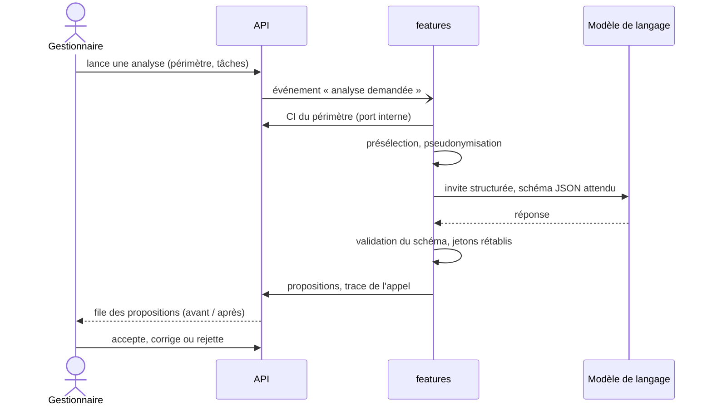

# 🧹 CMDB assistée

> [Fonctionnalité optionnelle](fonctionnalites-optionnelles.md) (clé `assisted-cmdb`,
> conteneur commun `features`). Un modèle de langage, dans le SI ou hébergé au choix de
> l'Admin, propose de renommer, normaliser, reclasser, fusionner et relier des CI, et aide
> au rapprochement des actifs du sas. Ses propositions entrent dans le circuit de la
> [gestion de la configuration](processus/gestion-de-la-configuration.md) : un
> gestionnaire les décide une à une, avec l'avant et l'après, comme les relations
> proposées par la découverte ([CFG-55](processus/gestion-de-la-configuration.md)).
> Préfixe des règles : **CMA**. Décision : [ADR-0023](../decisions/adr-0023-fonctionnalites-optionnelles-et-modele-de-langage.md).

[← Fonctionnalités optionnelles](fonctionnalites-optionnelles.md) · [Gestion de la configuration](processus/gestion-de-la-configuration.md) · [Règles métier](regles-metier.md)

## 1. Objectif

Une CMDB alimentée par plusieurs sources (saisie, import, découverte, annuaire) accumule
des noms hétérogènes (« SRV-PAIE-01 », « srvpaie1 », « Serveur paie prod »), des systèmes
écrits de dix façons, des types manquants et des dépendances qui ne sont écrites que dans
les descriptions. La CMDB assistée traite ce **texte**, que les règles exactes ne savent
pas lire.

Ce qui existe déjà, et qu'elle ne refait pas :

| Existant | Règle |
|---|---|
| Sas obligatoire : rien n'entre dans la CMDB sans réconciliation | [CFG-40](processus/gestion-de-la-configuration.md) |
| Rapprochement par numéro de série, adresse MAC, nom d'hôte | [CFG-41](processus/gestion-de-la-configuration.md) |
| Relations proposées par la découverte (« Héberge », flux réseau) | [CFG-55, CFG-56](processus/gestion-de-la-configuration.md) |
| Shadow IT, obsolescence | [CFG-42, CFG-47](processus/gestion-de-la-configuration.md) |
| Unicité du nom par environnement | [CFG-17](processus/gestion-de-la-configuration.md) |
| Import en masse | [CFG-30](processus/gestion-de-la-configuration.md) |

## 2. Fonctionnement

## 3. Règles

| ID | Règle | Statut | Lot |
|---|---|---|---|
| CMA-01 | **Analyse** : un gestionnaire du périmètre lance une analyse sur tout le périmètre ou sur une sélection de CI (500 au plus, `AssistedCmdb:MaxItems` ; tout le périmètre aussi, hors CI retirés), en choisissant ses tâches (CMA-02). Une seule analyse à la fois par périmètre (409 sinon) ; sans compte rendu du conteneur depuis 30 minutes (`AssistedCmdb:StaleMinutes`), une analyse est interrompue, en échec, et ne bloque plus ; elle est mise en file, puis En cours, Terminée ou En échec (motif affiché, [OPT-28](fonctionnalites-optionnelles.md#4-connecteur-de-modèle-de-langage)) | 🔜 (lancement et suivi côté API, #367 5a-1 ; remise au conteneur et exécution, 5a-2 et 5a-3 ; page, 5a-5) | 3 |
| CMA-02 | **Propositions typées** ([OPT-14](fonctionnalites-optionnelles.md#3-contrat-entre-lapi-et-le-conteneur-des-fonctionnalités)), chacune avec sa cible, l'avant, l'après et un motif court : **Renommer** un CI selon la convention (CMA-04) ; **Normaliser** l'écriture du système, du constructeur ou du modèle (« Win2019 std » → « Windows Server 2019 Standard ») ; **Reclasser** un CI dans un type de la liste (`Application`, `Serveur`, `Base de données`, `Réseau`, `Stockage`, `Poste de travail`, `Logiciel`, `Autre`) ; **Fusionner** deux CI (CMA-05) ; **Relier** deux CI existants par une relation de la liste (« Dépend de », « Héberge », « Fait partie de », « Se connecte à ») ; **Criticité** d'une application qui n'en a pas (Vitale, Majeure, Standard, Mineure, [CFG-43](processus/gestion-de-la-configuration.md)) | 🔜 | 3 |
| CMA-03 | **Décision** ([OPT-15](fonctionnalites-optionnelles.md#3-contrat-entre-lapi-et-le-conteneur-des-fonctionnalités)) : un utilisateur qui a le droit de modifier le CI accepte (au besoin en corrigeant), rejette ou laisse ; une à une, ou par sélection dans la file. Accepter passe par les règles de la pratique : un renommage qui viole l'unicité ([CFG-17](processus/gestion-de-la-configuration.md)) est refusé (409) et la proposition reste ouverte. Le journal d'audit porte l'origine « CMDB assistée » ([OPT-08](fonctionnalites-optionnelles.md#2-activation)) | 🔜 | 3 |
| CMA-04 | **Convention de nommage**, tenue par les gestionnaires dans Paramétrage : une description et des exemples par type de CI, transmis au modèle. Sans convention pour un type, la tâche Renommer ne s'y applique pas | 🔜 | 3 |
| CMA-05 | **Fusion** : le gestionnaire choisit le CI conservé (la proposition en suggère un). Les liens, les relations et les actifs du sas rapprochés du doublon lui sont reportés, sans relation vers lui-même ni en double ; le doublon passe au statut **Retiré**, avec le motif « Fusionné dans <référence> » ; l'opération est tracée au journal d'audit des deux CI. Refusée (400) entre deux périmètres ou deux environnements différents | 🔜 | 3 |
| CMA-06 | **Doublons candidats** : le conteneur présélectionne lui-même les paires à soumettre (même périmètre, même environnement, types compatibles, noms proches une fois normalisés) ; le modèle ne juge que ces paires, 50 au plus par requête, et ne voit jamais toute la CMDB. Une paire rejetée n'est plus soumise | 🔜 | 3 |
| CMA-07 | **Données envoyées** : nom, type, environnement, système, constructeur, modèle, description (1 000 caractères au plus) et relations existantes des CI analysés, **pseudonymisés** ([OPT-24](fonctionnalites-optionnelles.md#4-connecteur-de-modèle-de-langage)) : adresses IP et MAC, numéros de série, noms d'hôte, comptes des propriétaires. Aucun identifiant du coffre ni secret. Une requête ne porte que des CI d'un seul périmètre | 🔜 | 3 |
| CMA-08 | **Aide au sas** : pour un actif À rapprocher ou En conflit que [CFG-41](processus/gestion-de-la-configuration.md) n'a pas rapproché, la CMDB assistée propose un CI candidat, ou un type pour la création, avec son motif ; la proposition s'affiche sur la fiche de l'actif, et la décision reste celle de [CFG-40](processus/gestion-de-la-configuration.md). Elle se déclenche à la fin d'une tâche de découverte dont l'option « Analyser avec la CMDB assistée » est cochée | 🔜 | 3 |
| CMA-09 | **Sortie validée** ([OPT-25](fonctionnalites-optionnelles.md#4-connecteur-de-modèle-de-langage)) : une proposition qui cite un CI inconnu ou hors de l'analyse, un type ou une relation hors liste, une relation d'un CI vers lui-même ou une relation qui existe déjà est écartée et comptée | 🔜 | 3 |
| CMA-10 | **Mesure** : par tâche, sur 30 et 90 jours, la part des propositions acceptées, corrigées, rejetées et expirées, la part des réponses non conformes et la durée des analyses ([OPT-27](fonctionnalites-optionnelles.md#4-connecteur-de-modèle-de-langage)) ; affichée dans Administration › Fonctionnalités optionnelles › CMDB assistée | 🔜 | 3 |
| CMA-11 | **Jeu d'essai** : une CMDB fictive d'au moins 50 CI, avec ses réponses attendues (doublons, types, relations, normalisations), mesure chaque tâche sur au moins un modèle exécutable dans le SI ; la précision par tâche, la durée et la mémoire nécessaire sont consignées ici avant la version stable. Une tâche dont la précision mesurée reste sous 70 % est coupée par défaut | 🔜 | 3 |
| CMA-12 | **Réglages** (Admin) : tâches proposées aux gestionnaires, nombre maximal de CI par analyse et de paires par requête, aide au sas activée ou non | 🔜 | 3 |

## 4. Interface

| Endroit | Contenu | Statut |
|---|---|---|
| Configuration › **CMDB assistée** (gestionnaires) | Lancer une analyse (CMA-01), suivre les analyses, file des propositions filtrée par tâche, statut et périmètre, avant et après côte à côte, décision une à une ou par sélection | 🔜 |
| Fiche CI | Encadré « Propositions » quand il en reste d'ouvertes | 🔜 |
| Sas de staging, fiche d'un actif | Proposition de CI candidat ou de type (CMA-08) | 🔜 |
| Paramétrage › Convention de nommage | Description et exemples par type de CI (CMA-04) | 🔜 |
| Administration › Fonctionnalités optionnelles › CMDB assistée | Réglages (CMA-12), mesure (CMA-10) | 🔜 |

## 5. API

| Route | Policy | Rôle |
|---|---|---|
| `POST /api/assisted-cmdb/analyses` (périmètre, tâches, CI choisis) | Gestionnaire du périmètre | Lancer une analyse (CMA-01) : `{ perimeterId, tasks: ["rename" \| "normalize" \| "reclassify" \| "merge" \| "relate" \| "criticality"], configurationItemIds? }` ; sans `configurationItemIds`, tout le périmètre hors CI retirés ; `202` et l'analyse « En file » ; 400 tâche inconnue, sélection vide, hors du périmètre ou trop grande ; 403 hors gestionnaire ; 409 une analyse active |
| `GET /api/assisted-cmdb/analyses?perimeter=`, `GET /api/assisted-cmdb/analyses/{id}` | Gestionnaire du périmètre | Suivre (CMA-01) : `{ id, perimeterId, perimeterName, tasks, wholePerimeter, itemCount, status, reason, proposalCount, rejectedCount, requestedBy, requestedAt, startedAt, finishedAt }` ; sans `perimeter`, les 50 dernières des périmètres gérés ; une analyse d'un autre périmètre : 404 |
| Décision | — | Routes communes des propositions ([OPT-15](fonctionnalites-optionnelles.md#6-api)) |
| `GET /api/assisted-cmdb/naming`, `PUT /api/assisted-cmdb/naming/{ciType}` | User (lecture), gestionnaire (écriture) | Convention de nommage (CMA-04) |
| `GET /api/admin/assisted-cmdb/metrics` | Admin | Mesure (CMA-10) |
| `GET /internal/assisted-cmdb/analyses/{id}`, `PUT /internal/assisted-cmdb/analyses/{id}` | Jeton du conteneur `features`, CMDB assistée activée | Analyse annoncée par le fil (`analysis.requested`) : `{ id, perimeterId, tasks, configurationItemIds, status, itemCount }` (`configurationItemIds` null : tout le périmètre). Compte rendu (CMA-01) : `{ status, reason, proposalCount, rejectedCount }` ; En file → En cours ou En échec, En cours → En cours (lot suivant, l'analyse reste vivante), Terminée ou En échec ; une analyse finie ne change plus (409) ; En échec sans motif : 400 (OPT-28) |
| `GET /internal/configuration-items?perimeter=&after=`, `?ids=` | Jeton du conteneur `features` | CI d'un périmètre hors retirés, 200 par page par identifiant croissant, CMDB assistée activée (403 sinon : le tri ne lit que des CI désignés) ; ou des CI désignés, 50 au plus (OPT-13) |
| `GET /internal/discovery/staging/{id}`, `POST /internal/language-model/calls` (trace) | Jeton du conteneur `features` | Lectures et comptes rendus du conteneur (OPT-13, OPT-27) |
| `POST /language-model/test`, `GET /health` (conteneur `features`) | Jeton du conteneur | Appelées par l'API ([OPT-26](fonctionnalites-optionnelles.md#4-connecteur-de-modèle-de-langage), OPT-01) |

## 6. Scénarios d'acceptation

- **CMA-03** — *Étant donné* une proposition « Renommer srvpaie1 en SRV-PAIE-01 » alors qu'un CI SRV-PAIE-01 existe en Production, *quand* le gestionnaire l'accepte, *alors* l'API refuse (409, CFG-17) et la proposition reste ouverte.
- **CMA-05** — *Étant donné* deux CI « Serveur paie prod » et « SRV-PAIE-01 », reliés chacun à des incidents, *quand* le gestionnaire accepte la fusion en gardant SRV-PAIE-01, *alors* les liens et relations sont reportés, « Serveur paie prod » passe Retiré avec le motif « Fusionné dans … », et les deux historiques le tracent.
- **CMA-06** — *Étant donné* une paire rejetée « pas un doublon », *quand* une nouvelle analyse tourne, *alors* la paire n'est pas soumise au modèle.
- **CMA-07** — *Étant donné* une analyse du périmètre Siège, *alors* aucune requête au modèle ne contient un CI de l'Usine, ni une adresse IP, MAC ou un numéro de série en clair.
- **CMA-09** — *Étant donné* une réponse du modèle qui propose « Relier CI-2026-0012 Héberge CI-2026-0012 », *alors* la proposition est écartée et comptée parmi les non conformes.

## 7. Hors de cette version

- **Périmètre NIS 2 d'un CI** (`Nis2Scope`) : la directive qualifie des **entités**
  (essentielles ou importantes), et le rattachement d'un actif au périmètre réglementaire
  est une décision de l'organisation ; il n'est pas proposé par un modèle. Les preuves
  NIS 2 nourries par la découverte restent au chantier F13 ([plan d'action](../plan-action.md)).
- **Application en masse sans revue** : jamais ([ADR-0023](../decisions/adr-0023-fonctionnalites-optionnelles-et-modele-de-langage.md)).
