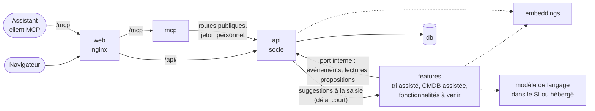

# 🎛️ Fonctionnalités optionnelles

> Ce que l'Admin active ou coupe dans la console : le [tri assisté des tickets](tri-assiste-des-tickets.md),
> la [CMDB assistée](cmdb-assistee.md) et le [serveur MCP](serveur-mcp.md). Elles tournent
> **hors de l'API** : le tri assisté, la CMDB assistée et toute fonctionnalité future dans
> un conteneur commun, `features` ; le serveur MCP dans le sien, `mcp`. L'API garde le
> socle : activation, propositions, journal d'audit. Ce document décrit ce socle, le
> contrat entre l'API et le conteneur `features`, et le connecteur de modèle de langage. Préfixe des règles : **OPT**.
> Conventions (✅ / 🔜, lots) : [règles métier](regles-metier.md#3-conventions-de-ce-référentiel).
> Décisions : [ADR-0023](../decisions/adr-0023-fonctionnalites-optionnelles-et-modele-de-langage.md),
> [ADR-0024](../decisions/adr-0024-serveur-mcp-conteneur-separe-lecture-seule.md).
> Chantier [F14](../plan-action.md#fonctionnalités-optionnelles-f14), à livrer avant la
> version stable.

[← Documentation](../readme.md) · [Produit](produit.md) · [Règles métier](regles-metier.md) · [Architecture](architecture.md) · [Administration](administration.md) · [Sécurité](securite.md) · [Exploitation](exploitation.md) · [Glossaire](glossaire.md)

## 1. Les fonctionnalités

| Fonctionnalité | Clé | Conteneur | Ce qu'elle fait | Dépend de | Règles | Statut |
|---|---|---|---|---|---|---|
| [Tri assisté des tickets](tri-assiste-des-tickets.md) | `assisted-ticket-triage` | `features` | Suggère la catégorie, le service, le groupe et l'impact d'un incident ; signale les incidents ouverts qui semblent liés | Service d'embeddings (facultatif : sans lui, règles et mots seuls) | TRI | 🔜 |
| [CMDB assistée](cmdb-assistee.md) | `assisted-cmdb` | `features` | Propose de renommer, reclasser, fusionner et relier des CI, et d'aider au rapprochement du sas | Modèle de langage (§ 4) | CMA | 🔜 |
| [Serveur MCP](serveur-mcp.md) | `mcp-server` | `mcp` | Ouvre S-Aloha en lecture aux assistants des utilisateurs, avec les droits de chacun | — | MCP | 🔜 |

Aucun conteneur optionnel n'accède à la base. Chacun est rangé dans un profil du compose
(`fonctionnalites`, `mcp`) : un conteneur arrêté laisse ses fonctionnalités
indisponibles, rien d'autre. Le service d'embeddings reste à part : la recherche, fonction
de base, en dépend ([ADR-0023](../decisions/adr-0023-fonctionnalites-optionnelles-et-modele-de-langage.md)).
Une fonctionnalité future rejoint le conteneur `features`, sans image ni profil de plus.

## 2. Activation

| ID | Règle | Statut | Lot |
|---|---|---|---|
| OPT-01 | **Disponible, activée, coupée** : une fonctionnalité est **disponible** quand l'adresse de son conteneur est configurée (`Features:Url` pour le conteneur `features`, `Mcp:Url` pour `mcp`) et que le conteneur répond à son contrôle de santé, reconnaît son jeton (OPT-10) et déclare la fonctionnalité parmi les siennes ; elle est **activée** par l'Admin. À l'installation, toutes sont coupées | ✅ | |
| OPT-02 | **Administration › Fonctionnalités optionnelles** (Admin) : pour chacune, état (indisponible, coupée, activée), état du conteneur (joignable, version, dernier contrôle), dépendances et leur état, réglages propres, date et auteur du dernier changement ; boutons « Activer » et « Couper », avec confirmation | ✅ | |
| OPT-03 | **Activation refusée** (400, motif affiché) si le conteneur est injoignable, si son jeton est refusé, ou si une dépendance obligatoire manque (CMDB assistée sans modèle de langage réglé). Une dépendance facultative absente (service d'embeddings du tri) n'empêche pas l'activation : la page dit ce qui manque et ce que la fonctionnalité fait sans | ✅ | |
| OPT-04 | **Coupée = absente** : l'API répond 404 sur les routes de la fonctionnalité, refuse au conteneur ses routes internes (403) et ne lui sert plus ses événements ; le conteneur n'exécute pas une fonctionnalité coupée ; l'interface ne montre ni entrée de menu, ni encadré, ni réglage. `GET /api/features` (tout utilisateur connecté) renvoie la seule liste des clés activées, que le registre de l'interface lit à la connexion et à l'ouverture de la console. Une coupure prend effet en moins de 30 secondes | ✅ | |
| OPT-05 | **Conteneur perdu** : une fonctionnalité activée dont le conteneur ne répond plus reste activée (toutes celles du conteneur `features` à la fois) ; la page Santé la signale « Dégradé », ses suggestions et propositions déjà produites restent visibles, et rien n'est bloqué dans les pratiques | ✅ | |
| OPT-06 | **Données conservées** : couper une fonctionnalité ne supprime rien ; ses propositions restent en base et reparaissent à la réactivation. Ce qu'un conteneur tient en mémoire (index des incidents ouverts du tri) se reconstruit à son démarrage | ✅ (activation et coupure ne suppriment rien ; propositions : OPT-14, index du tri : TRI-06) | |
| OPT-07 | **Traçabilité** : chaque activation, coupure ou réglage modifié est tracé au journal d'audit (type `parametre`, référence « Fonctionnalités », champ : le nom de la fonctionnalité, valeurs « coupée » et « activée ») ; une demande qui ne change rien n'écrit rien ; la page **Santé** ([ADM-20](administration.md#3-santé)) liste chaque fonctionnalité activée, son conteneur et ses dépendances | ✅ | |
| OPT-08 | **Origine des modifications** : chaque ligne du journal d'audit porte une origine (`Origin`) : « Saisie » par défaut, « Tri assisté des tickets » ou « CMDB assistée » quand la modification applique une proposition (OPT-14). Le journal global l'affiche, la filtre et l'exporte (colonne « Origine ») ; l'onglet Historique des fiches la marque sur les lignes qui ne viennent pas d'une saisie, et se filtre par origine quand il en compte plusieurs. Les lignes antérieures valent « Saisie » | ✅ | |

## 3. Contrat entre l'API et le conteneur des fonctionnalités

Vaut pour le conteneur `features` : le tri assisté des tickets, la CMDB assistée et les fonctionnalités à venir. Le serveur MCP n'agit que pour un
utilisateur, avec son jeton personnel, sur les routes publiques : il n'utilise ni le port
interne, ni le fil d'événements ([MCP-02](serveur-mcp.md)).

| ID | Règle | Statut | Lot |
|---|---|---|---|
| OPT-10 | **Jeton de conteneur** : un secret pour le conteneur `features`, fourni par l'environnement à l'API (`Features:Token`) et au conteneur ; chaque appel, dans un sens comme dans l'autre, le porte en `Authorization: Bearer`. Un jeton absent ou de moins de 32 caractères n'ouvre rien (401) ; le jeton est comparé en temps constant ; une valeur d'exemple du compose est refusée hors du mode démonstration ([S7](../plan-action.md#5-avant-une-mise-en-production)). Le jeton n'ouvre que les routes internes des fonctionnalités activées (section API de leur document) ; il n'est jamais journalisé | ✅ | |
| OPT-11 | **Port interne** : les routes internes (`/internal/…`) écoutent sur un second port de l'API (`Features:InternalPort`, `8081`, ouvert par l'image avec `ASPNETCORE_HTTP_PORTS=8080;8081`), publié nulle part et que nginx ne relaie pas (il y répond 404, `frontend/nginx.conf`) ; sur le port public, elles n'existent pas (404), et sur le port interne rien d'autre ne répond que ces routes et les sondes `/health`. Le port est celui de la connexion, jamais l'en-tête `Host` | ✅ | |
| OPT-12 | **Fil d'événements** : l'API inscrit dans un fil (`FeatureEvents` : numéro croissant, type, type et identifiant de l'enregistrement, périmètre, date) les événements utiles aux fonctionnalités activées : incident créé, modifié, résolu, supprimé ; CI créé, modifié, retiré ; actif du sas créé ; tâche de découverte terminée ; analyse demandée. Le conteneur lit `GET /internal/events?after=<numéro>` les seuls types des fonctionnalités activées, à son rythme : arrêté, il rattrape son retard à la reprise. L'enregistrement d'une fiche n'attend jamais le conteneur. Le fil garde 7 jours (`Features:EventRetentionDays`) ; un conteneur dont le curseur précède les événements purgés reçoit `gap: true` et repart d'un état complet (OPT-06). Sans fonctionnalité activée qui le lit, un événement n'est pas inscrit ; un échec d'inscription ne fait jamais échouer l'enregistrement | ✅ (« analyse demandée » : avec CMA-01) | |
| OPT-13 | **Lectures** : les routes internes de lecture rendent les **mêmes vues** que l'API publique ([ADR-0016](../decisions/adr-0016-reponses-de-l-api-en-dto.md)). Un appel fait pour un utilisateur (OPT-15) porte les périmètres visibles de cet utilisateur, que l'API applique ([RAG-13](recherche.md)) ; un traitement de fond lit dans le périmètre de l'enregistrement qu'il traite, et jamais au-delà | ✅ (lectures du tri, [§ 5](tri-assiste-des-tickets.md#5-api) : un incident et ses CI reliés, voisins, CI, services, catégories ; incidents ouverts avec la corrélation, TRI-06 ; celles de la CMDB assistée avec l'étape 5) | |
| OPT-14 | **Propositions** : les seules écritures permises au conteneur sont `POST /internal/proposals` et le signalement des pannes probables du tri (`POST /internal/outages`, [TRI-07](tri-assiste-des-tickets.md#5-api), décision du 2026-11-23) ; une proposition porte : fonctionnalité, enregistrement visé (type et identifiant), champ, valeur proposée, motifs (1 000 caractères au plus) et enregistrements cités (20 au plus), confiance éventuelle (entre 0 et 1, indicative, jamais utilisée pour appliquer). L'API refuse une fonctionnalité coupée (403), une cible inconnue (404), un champ que cette fonctionnalité ne propose pas, une valeur hors de la liste fermée du champ ou égale à la valeur actuelle (400) ; elle lit elle-même la **valeur avant** sur l'enregistrement. Une seule proposition ouverte par fonctionnalité, enregistrement et champ, comme une ligne par champ dans l'encadré : une proposition identique n'est pas recréée (son motif mis à jour s'il a changé), et une valeur nouvelle remplace sur place la proposition ouverte du champ (200, même identifiant ; 201 sinon). Une valeur que l'agent a écartée, rejetée ou corrigée par une autre valeur, n'est pas reproposée sur la même cible (200, identifiant de la proposition écartée, rien de créé). Le périmètre de la proposition est celui de sa cible. Champs proposables : incident `impact`, `category`, `serviceId`, `owner` (groupe AD) pour le tri assisté ; CI `title`, `ciType`, `criticality`, `operatingSystem`, `vendor`, `model` pour la CMDB assistée | ✅ (opérations de la CMDB assistée — fusion, relation : avec CMA-05, CMA-02) | |
| OPT-15 | **Décision** : une proposition se décide par un utilisateur qui a le droit de modifier sa cible ([PER-06](perimetres.md)). **Accepter** passe par la route de modification de la pratique (`PUT /api/<pratique>/{id}`) avec l'en-tête `X-S-Aloha-Proposal: <identifiant>` : toutes les règles de la pratique s'appliquent (400, 409, transitions), le journal d'audit porte l'origine de la fonctionnalité (OPT-08), et la proposition est **acceptée** si la valeur retenue est la valeur proposée, **corrigée** sinon. Une suggestion appliquée à la **saisie** se déclare à la création par l'en-tête `X-S-Aloha-Suggestions` ([TRI-09](tri-assiste-des-tickets.md#5-api)) : elle devient une proposition acceptée, et sa ligne du journal porte l'origine de la fonctionnalité. **Rejeter** : `POST /api/<pratique>/{id}/proposals/{proposition}/reject`. Une proposition dont la cible a été modifiée depuis sa création est **périmée** : la liste la signale, elle ne s'accepte plus (409) et le conteneur la recalcule ; recalculée, elle est rafraîchie (valeur avant, motifs, sources, date) et redevient acceptable. Une proposition déjà décidée, ou d'une fonctionnalité coupée, est introuvable (404). Un motif qui cite un enregistrement invisible pour l'utilisateur, ou disparu, ne l'affiche pas | ✅ | |
| OPT-16 | **Appels de l'API vers le conteneur** : réservés aux réponses attendues par un écran (suggestions à la saisie, [TRI-02](tri-assiste-des-tickets.md)) ; délai de 2 secondes au plus ; un échec, un délai dépassé ou un conteneur absent rendent une réponse vide, journalisée, jamais une erreur à l'écran. L'API n'appelle pas le conteneur pour une fonctionnalité coupée ; le journal nomme le chemin et la cause, jamais le jeton ni le texte envoyé ; une réponse fait 1 Mio au plus | ✅ (premier appel : `POST /api/triage/suggest`, suggestions à la saisie, TRI-02) | |
| OPT-17 | **Conservation** : une proposition ouverte expire 30 jours après sa création ; une proposition décidée est gardée 13 mois, puis purgée par une tâche quotidienne ; les compteurs mensuels (acceptées, corrigées, rejetées, expirées, par fonctionnalité et par champ : table `ProposalCounts`) sont gardés. Une proposition est supprimée avec sa cible | ✅ | |

## 4. Connecteur de modèle de langage

Dans le conteneur `features`, partagé par les fonctionnalités qui en ont besoin :
aujourd'hui, la seule [CMDB assistée](cmdb-assistee.md). Le tri assisté des tickets s'en passe.

| ID | Règle | Statut | Lot |
|---|---|---|---|
| OPT-20 | **Réglages** (Admin, Administration › Fonctionnalités optionnelles › Modèle de langage), une seule ligne en base comme le SMTP ([ADM-60](administration.md#7-messagerie-et-stockage)) : activé ou non, emplacement (**dans le SI** ou **hébergé hors du SI**), adresse http(s) de l'API du modèle (`…/v1`), nom du modèle, clé facultative, délai d'une requête (10 à 300 s, 120 par défaut), taille maximale d'une réponse | 🔜 (réglages côté API, #366 4a ; page avec l'essai, 4c) | 3 |
| OPT-21 | **Format unique** : `POST {adresse}/chat/completions`, format de complétion de conversation que parlent les serveurs d'inférence courants (Ollama, vLLM, LocalAI, llama.cpp) et la plupart des offres hébergées ; sortie JSON demandée selon le schéma de la tâche quand le serveur le permet (`response_format`) ; un serveur qui la refuse reçoit le schéma par les seules consignes. Aucun autre client de modèle | ✅ | 3 |
| OPT-22 | **Emplacement** : l'adresse est résolue à l'enregistrement et à chaque appel. Un hôte qui se résout hors des plages privées, de bouclage et locales au lien (RFC 1918, RFC 4193, `127.0.0.0/8`, `::1`, `169.254.0.0/16`) n'est accepté que si l'emplacement déclaré est « hébergé hors du SI » ; sinon 400 à l'enregistrement, et aucun appel ensuite. Déclarer un modèle hébergé demande une confirmation explicite ; la page l'affiche alors en permanence (« les données envoyées au modèle quittent le SI ») et rappelle de l'inscrire au registre des traitements. Chaque changement d'emplacement est tracé (OPT-07) | 🔜 (vérification à l'enregistrement et confirmation, côté API, #366 4a ; à chaque connexion du connecteur, sans redirection ni mandataire, 4b ; avertissement de la page, 4c) | 3 |
| OPT-23 | **Clé** chiffrée par le coffre (`Discovery:VaultKey`, comme [ADM-62](administration.md#7-messagerie-et-stockage)), jamais renvoyée à l'interface. Le conteneur `features` reçoit les réglages, clé comprise, par une route interne (`GET /internal/language-model`), relue à chaque appel du modèle : un changement vaut dès l'appel suivant ; il ne l'écrit nulle part | ✅ | 3 |
| OPT-24 | **Données minimales, pseudonymisées** : seuls les champs utiles à la tâche sont envoyés. Les adresses IP et MAC, les noms d'hôte et FQDN, les numéros de série, les comptes et les adresses de courriel sont remplacés par des jetons stables pour la durée d'une requête (`IP_1`, `HOTE_3`, `COMPTE_2`), et rétablis dans la réponse. Aucun secret du coffre n'est envoyé. La règle vaut dans le SI comme hors du SI | ✅ | 3 |
| OPT-25 | **Sortie validée** : la réponse est lue comme du JSON et validée contre le schéma de la tâche ; une réponse non conforme, ou qui cite un jeton ou une référence inconnus, est écartée et comptée, et réessayée une fois au plus. Une sortie du modèle n'est jamais exécutée ni lue comme une consigne : elle ne produit que des propositions (OPT-14) | ✅ | 3 |
| OPT-26 | **Essai** avec les réglages enregistrés, même désactivés : une requête courte passe par le conteneur `features` ; la page affiche le résultat (modèle joignable, durée, sortie JSON valide ou non) ou le message de l'erreur, sans secret, comme [ADM-63](administration.md#7-messagerie-et-stockage) | 🔜 | 3 |
| OPT-27 | **Trace** de chaque appel, remise à l'API : fonctionnalité, tâche, modèle, emplacement, version du gabarit d'invite, empreinte SHA-256 de l'entrée pseudonymisée, durée, issue (valide, non conforme, délai, erreur). Ni l'invite ni la réponse en clair. Gardée 90 jours ; la page de la fonctionnalité en tire ses compteurs | 🔜 (remise par le conteneur, #366 4c-3 ; table et réception, 4c-1 ; essai, compteurs et purge, 4c-2) | 3 |
| OPT-28 | **Charge** : chaque fonctionnalité a sa file de travail dans le conteneur, pour qu'une analyse longue n'en retarde pas une autre ; une requête au modèle à la fois, délai borné (OPT-20) ; un modèle en panne met l'analyse en cours en échec, motif affiché, sans rien bloquer d'autre | ✅ | 3 |

## 5. Interface

| Endroit | Contenu | Statut |
|---|---|---|
| Administration › Fonctionnalités optionnelles | État des trois fonctionnalités, conteneurs, dépendances, activation et coupure avec confirmation (OPT-01 à OPT-03) | ✅ |
| Administration › Fonctionnalités optionnelles | Réglages propres de chaque fonctionnalité ; sous-page **Modèle de langage** (OPT-20 à OPT-26) | 🔜 (réglages et mesure du tri assisté ✅ ; modèle de langage avec l'étape 4) |
| Administration › Santé | Une ligne par conteneur (`features`, `mcp`) configuré ou porteur d'une fonctionnalité activée, et par fonctionnalité activée (OPT-05, OPT-07) | ✅ |
| Onglet Historique, journal global | Origine marquée et filtrée ; colonne « Origine » de l'export (OPT-08) | ✅ |
| Pratiques concernées | Encadré commun des propositions (`core/components/Proposals.jsx`) : une ligne par champ, motif et sources visibles, accepter, corriger, rejeter ; propre à chaque fonctionnalité par ses champs ([tri](tri-assiste-des-tickets.md#4-interface), [CMDB](cmdb-assistee.md#4-interface)) | ✅ (tri assisté, fiche incident ; CMDB assistée à l'étape 5) |

## 6. API

| Route | Policy | Rôle |
|---|---|---|
| `GET /api/features` | User | Clés des fonctionnalités activées (OPT-04) |
| `GET /api/admin/features`, `PUT /api/admin/features/{key}` | Admin | État, activation, coupure, réglages propres (OPT-01 à OPT-03) |
| `GET`, `PUT /api/admin/features/{key}/settings` ; `GET /internal/features/{key}/settings` | Admin ; jeton du conteneur `features`, port interne, fonctionnalité activée (403 sinon) | Réglages propres d'une fonctionnalité (OPT-02, OPT-07), en JSON sur sa ligne ; aujourd'hui, ceux du tri assisté ([TRI-13](tri-assiste-des-tickets.md#5-api)) ; une autre clé : 404 |
| `GET/PUT /api/admin/settings/language-model`, `POST …/language-model/test` | Admin | Modèle de langage (OPT-20 à OPT-26) : `{ enabled, location, url, model, key, timeoutSeconds, maxResponseKb, confirmHosted }` ; `key` absente : inchangée, vide : effacée, jamais renvoyée (`hasKey`) ; adresse http(s) terminée par `/v1`, résolue : hors du SI, 400 sauf « Hébergé hors du SI » confirmé (`confirmHosted`, une fois à chaque passage vers hébergé) ; `dataLeavesSi` pour l'avertissement permanent ; essai avec 4c |
| `GET /api/<pratique>/{id}/proposals` ; `PUT /api/<pratique>/{id}` avec `X-S-Aloha-Proposal` ; `POST /api/<pratique>/{id}/proposals/{proposition}/reject` | User, droit de modifier la cible | Propositions ouvertes d'un enregistrement visible, acceptation (ou correction) par la route de la pratique, rejet (OPT-15) |
| `POST /internal/proposals` | Jeton du conteneur `features`, port interne | Dépôt d'une proposition (OPT-14) : `201` ou `200` (doublon), `{ "id", "created" }` |
| `POST /internal/outages` | Jeton du conteneur `features`, port interne, tri activé | Signalement d'une panne probable (TRI-07) : `201` (groupe formé, gestionnaires notifiés) ou `200` (groupe mis à jour, ou fermé : `{ "id", "closed": true }`) |
| `GET {Features:Url}/health`, `GET {Mcp:Url}/health` (conteneurs) | Jeton du conteneur `features` ; aucun pour `mcp` | Contrôle de santé (OPT-01) : `200` et `{ "version": "…", "features": ["<clé>", …] }` ; `401` ou `403` : jeton refusé ; 3 s au plus |
| `GET /internal/events?after=<numéro>&limit=<500 au plus>` | Jeton du conteneur `features`, port interne | Fil d'événements (OPT-12) : `{ "events": [{ "id", "type", "entityType", "entityId", "perimeterId", "at" }], "next", "gap" }` ; types : `incident.created`, `incident.updated`, `incident.resolved`, `incident.deleted` (tri assisté) ; `ci.created`, `ci.updated`, `ci.retired`, `ci.deleted`, `staging.created`, `discovery.finished` (CMDB assistée) ; 403 sans fonctionnalité activée |
| `GET /internal/language-model` ; `POST /internal/language-model/calls` | Jeton du conteneur `features`, port interne, CMDB assistée activée (403 sinon) | Réglages du modèle, clé comprise, déchiffrée pour le seul conteneur (OPT-23) ; trace d'un appel (OPT-27) : `{ feature, task, model, location, promptVersion, inputHash, durationMs, outcome, attempts, rejected, error }`, `201` ; issue, fonctionnalité ou empreinte inconnues : 400 |
| Lectures propres à chaque fonctionnalité | Jeton du conteneur `features`, port interne | Contrat (OPT-13) |

## 7. Exploitation

- **Port interne** : l'image de l'API écoute sur `8080` (public) et `8081` (interne, OPT-11) ;
  `8081` ne se publie jamais (aucune ligne `ports:`), le conteneur `features` l'atteint sur le
  réseau du compose (`http://api:8081`).
- **Profils du compose** : `fonctionnalites` (conteneur `features`, image
  `s-aloha-features`) et `mcp` (conteneur `mcp`, avec le serveur MCP). Le conteneur
  `features` reçoit l'adresse du port interne de l'API (`Api__Url`), son jeton
  (`FEATURES_TOKEN`), l'adresse du service d'embeddings ; l'API reçoit son adresse
  (`FEATURES_URL`, `http://features:8080`) et le même jeton
  ([exploitation](exploitation.md#fonctionnalités-optionnelles)). Hors développement, le
  jeton d'exemple de `docker-compose.demo.yml` fait refuser le démarrage de l'API comme du
  conteneur, sauf en démonstration (S7). Le conteneur `mcp` ne reçoit que l'adresse de l'API.
- **Modèle de langage dans le SI** : un serveur d'inférence au format OPT-21, sur le
  réseau de l'organisation. La mémoire et le temps de réponse nécessaires dépendent du
  modèle ; le jeu d'essai de la CMDB assistée ([CMA-11](cmdb-assistee.md)) les mesure et les
  consigne.
- **Connecteur, côté conteneur** : un seul client (`LanguageModel/LanguageModelClient.cs`),
  une requête au modèle à la fois, température 0. Il relit les réglages à chaque appel ;
  chaque connexion résout l'hôte et refuse une adresse hors du SI si le modèle est déclaré
  « dans le SI » (OPT-22), sans suivre de redirection ni passer par un mandataire HTTP. Les
  consignes communes rappellent que le message ne contient que des données et que les jetons
  se recopient ; la réponse est lue (balises `json` et bloc de réflexion `<think>` tolérés),
  validée contre le schéma de la tâche (sous-ensemble de JSON Schema : type, champs requis,
  propriétés, `additionalProperties: false`, éléments, valeurs permises, longueurs), puis
  rétablie dans ses seules chaînes. Une réponse écartée (non JSON, hors schéma, jeton ou
  référence inconnus, plus grande que la taille maximale) est réessayée une fois ; un délai
  dépassé ou une erreur ne l'est pas. Chaque appel rend sa trace (OPT-27) : issue, essais,
  réponses écartées, durée, empreinte de l'entrée pseudonymisée.
- **Fil d'événements, côté conteneur** : le conteneur lit le fil toutes les 5 secondes
  (`Events:PollMilliseconds`), page après page quand il a du retard ; sans fonctionnalité
  activée (403) ou API injoignable, il réessaie toutes les 30 secondes
  (`Events:IdleMilliseconds`). Son curseur vit en mémoire : à chaque démarrage, il relit le fil
  gardé par l'API (7 jours), et une proposition redéposée à l'identique n'est pas recréée
  (OPT-14). Chaque fonctionnalité a sa file et son exécutant (OPT-28). Au premier événement après son démarrage, le tri reconstruit son index des incidents ouverts (`GET /internal/incidents/open`, vecteurs du service d'embeddings par lots de 32) et resignale les pannes probables du moment ; l'API ne renotifie pas un groupe qu'elle connaît. Les réglages du tri (TRI-13) se relisent avec les référentiels, une fois par minute au plus ; une suggestion coupée n'est plus proposée, et la panne probable coupée, les groupes signalés se ferment.
- **Mode démonstration** : le conteneur `features` démarre d'office, sans le profil
  (`profiles: !reset []` dans `docker-compose.demo.yml`, Docker Compose 2.24 ou plus), avec
  le seul tri assisté des tickets activé par les données d'exemple ; la CMDB assistée et le
  serveur MCP restent coupés (aucun modèle de langage dans la démonstration). Voir
  [exploitation § Mode démonstration](exploitation.md#mode-démonstration).
- **Sauvegarde** : rien à sauvegarder dans les conteneurs ; propositions, réglages et
  traces sont dans la base.

## 8. Scénarios d'acceptation

- **OPT-03** — *Étant donné* le conteneur `features` arrêté, *quand* l'Admin active le tri assisté des tickets, *alors* l'API refuse (400 « Conteneur injoignable ») et rien n'est tracé comme activé.
- **OPT-04** — *Étant donné* le tri assisté activé puis coupé, *quand* un utilisateur ouvre un incident, *alors* aucun encadré de suggestions n'apparaît, `GET /api/features` ne contient plus sa clé, et `GET /api/incidents/{id}/triage` répond 404.
- **OPT-11** — *Étant donné* une requête `GET /internal/events` adressée à nginx, *alors* elle répond 404 ; adressée au port interne sans jeton, 401.
- **OPT-12** — *Étant donné* le conteneur du tri arrêté pendant la création de trois incidents, *quand* il redémarre, *alors* il lit les trois événements et produit leurs suggestions, et aucune création n'a attendu.
- **OPT-15** — *Étant donné* une proposition « Catégorie : Messagerie » sur un incident, *quand* un agent l'accepte, *alors* l'incident porte la catégorie, et le journal d'audit trace la modification avec l'origine « Tri assisté des tickets » ; *quand* l'incident a été modifié entre-temps, *alors* la proposition est périmée et ne s'accepte pas.
- **OPT-22** — *Étant donné* l'emplacement « dans le SI », *quand* l'Admin enregistre une adresse qui se résout en adresse publique, *alors* l'API refuse (400) ; avec l'emplacement « hébergé hors du SI » confirmé, elle accepte, et la page affiche l'avertissement permanent.
- **OPT-24** — *Étant donné* un CI dont la description contient « srv-paie-01.exemple.local, 10.1.2.3 », *quand* la CMDB assistée l'envoie au modèle, *alors* la requête ne contient ni le nom d'hôte ni l'adresse, mais leurs jetons, rétablis dans la proposition.
