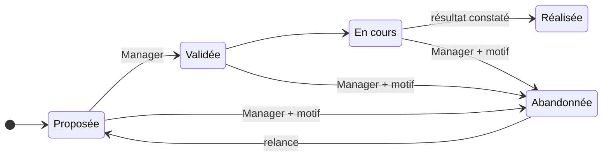

# 📈 Amélioration continue

> Pratique ITIL *Continual improvement*. Code : `backend/Modules/ContinualImprovement`,
> `frontend/src/modules/continual-improvement`. Préfixe des règles : **CSI**. Socle commun
> et conventions (✅ / 🔜, lots) : [règles métier](../regles-metier.md).

[← Règles métier](../regles-metier.md) · [Toutes les pratiques](readme.md)

## 1. Objectif et périmètre

*Objectif ITIL : aligner les pratiques et les services de l'organisation sur l'évolution
des besoins métier, par l'amélioration continue des produits, des services, des pratiques
et de tout élément de leur gestion.*

Le **registre d'amélioration continue** recense les opportunités d'amélioration, de la
proposition à la mesure du résultat, selon le **modèle d'amélioration continue ITIL** en
sept étapes. Toute pratique peut l'alimenter : un SLA non tenu, une tendance d'incidents,
un problème systémique, une suggestion. Hors périmètre : la gestion de portefeuille de
projets.

## 2. Rôles et droits

| Rôle ITIL | Rôle applicatif | Responsabilités |
|---|---|---|
| Contributeur | Tous | Propose une amélioration |
| Porteur | Responsable AD | Conduit l'amélioration, mesure le résultat |
| Gestionnaire de l'amélioration continue | Manager | Valide, priorise, abandonne, revoit le registre |

| Action | User | Manager | Admin | Statut |
|---|---|---|---|---|
| Proposer, modifier | ✔ | ✔ | ✔ | ✅ |
| Engager une amélioration validée, la déclarer réalisée | Porteur | ✔ | ✔ | ✅ CSI-11 (§ 4) |
| Changer le porteur d'une amélioration Validée ou En cours | Porteur | ✔ | ✔ | ✅ CSI-11 |
| Valider / abandonner | ✘ | ✔ | ✔ | ✅ |
| Changer la valeur, l'effort ou la priorité d'une amélioration Validée ou En cours | ✘ | ✔ | ✔ | ✅ CSI-12 |
| Supprimer | ✘ | ✘ | ✔ | ✅ |

## 3. Données

Champs communs (référence `AMI-AAAA-NNNN`, titre = opportunité, description, statut,
porteur AD, créateur, dates) : [socle](../regles-metier.md#5-règles-communes-aux-processus).

| Champ | Type | Oblig. | Valeurs / règle | Statut |
|---|---|---|---|---|
| `Step` | entier | ✔ | 1 à 7 (modèle ITIL, ci-dessous) | ✅ |
| `Priority` | texte 10 | ✔ | Faible, Moyenne, Élevée ; calculée dès que valeur et effort sont notés | ✅ CSI-12 |
| `Benefit` | texte | | Valeur attendue | ✅ |
| `Baseline`, `Target` | texte 300 | | Mesure de départ, mesure cible | ✅ |
| `Outcome` | texte | à la réalisation | Résultat constaté | ✅ |
| `DueDate` | date | | Échéance | ✅ |
| `ValidatedBy`, `ValidatedAt`, `CompletedAt` | texte, date | auto | SOC-08 | ✅ |
| `Source` | texte 20 | ✔ | Suggestion (défaut), Incident, Problème, SLA, Audit, Retour client ; l'enregistrement d'origine, s'il est donné à la proposition, est relié | ✅ CSI-10 |
| `Value`, `Effort` | entier 1–3 | à la validation | Valeur métier, effort estimé ; la priorité en découle. Exigés à l'entrée dans Validée (une amélioration validée avant la règle reste modifiable) ; sur une amélioration Validée ou En cours, changés par un gestionnaire seulement | ✅ CSI-12 |
| `AbandonReason` | texte | à l'abandon | Motif | ✅ |
| `FollowUpDate` | date | | Date de contrôle de la durabilité (étape 7) ; ne change plus une fois le contrôle conclu | ✅ CSI-15 |
| `FollowUpDoneAt`, `FollowUpDoneBy`, `FollowUpHolds`, `FollowUpNote` | date, texte, booléen, texte | auto | Conclusion du contrôle : le résultat tient ou non, constat | ✅ CSI-15 |

**Modèle d'amélioration continue ITIL** : 1. *Quelle est la vision ?* — 2. *Où en
sommes-nous ?* — 3. *Où voulons-nous être ?* — 4. *Comment y parvenir ?* — 5. *Passer à
l'action* — 6. *Y sommes-nous parvenus ?* — 7. *Comment maintenir la dynamique ?*

## 4. Cycle de vie

**Transitions (✅ CSI-11)** : seules les transitions ci-dessous sont permises (SOC-05), avec les conditions de statut.

| De → Vers | Qui | Conditions (400 sinon) | Effets | Statut |
|---|---|---|---|---|
| — → Proposée | Tous | Titre, étape | Référence | ✅ |
| Proposée → Validée | Manager | Valeur attendue, mesure de départ et mesure cible renseignées | `ValidatedAt`, `ValidatedBy` | ✅ |
| Validée → En cours | Porteur, Manager | Validée ; porteur renseigné | | ✅ (porteur d'avant la modification, membre du groupe porteur ou gestionnaire ; porteur exigé, #264) |
| En cours → Réalisée | Porteur, Manager | Résultat constaté ; étape ≥ 6 | `CompletedAt` | ✅ (résultat ; étape : CSI-16 ; qui : comme l'engagement, #264) |
| Proposée, Validée, En cours → Abandonnée | Manager | Motif | Validation retirée | ✅ |
| Abandonnée → Proposée | Tous | | Nouvelle validation nécessaire | ✅ |
| Réalisée → … | — | Statut final | | ✅ CSI-11 |

## 5. Règles de gestion

| ID | Règle | Statut | Lot |
|---|---|---|---|
| CSI-01 | Registre : opportunité, valeur attendue, mesure de départ et cible, priorité, porteur, échéance, résultat constaté | ✅ | |
| CSI-02 | Avancement selon le **modèle ITIL**, étape 1 à 7 ; hors de 1 à 7 ⇒ 400 | ✅ | |
| CSI-03 | **Validée** et **Abandonnée** : gestionnaire uniquement | ✅ | |
| CSI-04 | **En cours** et **Réalisée** exigent une amélioration validée ; **Réalisée** exige le résultat constaté | ✅ | |
| CSI-05 | **Abandonner**, comme revenir à Proposée, **retire la validation** : relancer demande une nouvelle validation | ✅ | |
| CSI-10 | **Source** de l'amélioration et lien vers l'enregistrement d'origine (incident, problème, SLA) quand il existe | ✅ |  |
| CSI-11 | **Transitions contraintes** selon le § 4 (SOC-05) ; Réalisée est finale. Le **porteur** d'une amélioration Validée ou En cours n'est changé que par le porteur en place (ou un membre du groupe porteur) ou par un gestionnaire du périmètre (400 sinon) : un tiers ne se désigne pas pour l'engager à l'envoi suivant. Une amélioration validée **sans porteur** est confiée par un gestionnaire (400 pour un User qui se désigne) ; proposée, son porteur se désigne librement | ✅ | 1 |
| CSI-12 | **Priorisation** : à la validation, le gestionnaire note la valeur et l'effort (1 à 3) ; la priorité est calculée : valeur 3 et effort 1–2 → Élevée ; valeur 1 et effort 2–3 → Faible ; sinon Moyenne. Sur une amélioration **Validée ou En cours**, valeur, effort et priorité ne changent que par un gestionnaire du périmètre (400 « La priorisation est une décision de gestionnaire » pour un User ; la fiche les fige) ; avant la validation, ils restent libres | ✅ |  |
| CSI-13 | **Abandon** motivé : le motif est obligatoire et visible sur la fiche | ✅ | 1 |
| CSI-14 | **Validation** exige valeur attendue, mesure de départ et mesure cible (une amélioration se mesure) | ✅ | 1 |
| CSI-15 | **Durabilité** (étape 7) : une amélioration Réalisée peut porter une date de contrôle ; à cette date, le porteur confirme que le résultat tient, ou ouvre une nouvelle amélioration reliée | ✅ (porteur ou gestionnaire, à partir de la date ; « ne tient pas » exige un constat et ouvre une amélioration Proposée « Reprise : … », même porteur, reliée ; notification au porteur et console, Mon travail, à la date ; encadré « Durabilité » de la fiche) | 3 |
| CSI-16 | **Réalisée** exige l'étape 6 au moins (« Y sommes-nous parvenus ? ») : le résultat est comparé à la cible | ✅ | 1 |

## 6. Délais, calculs et alertes

| ID | Règle | Statut | Lot |
|---|---|---|---|
| CSI-20 | **Amélioration proposée par le système** depuis un SLA sous la cible (SLM-23) ou un problème récurrent (PRB-23) : brouillon Proposée, source et lien renseignés, à valider par un gestionnaire | ✅ (problème récurrent, avec PRB-23 ; SLA sous la cible, avec SLM-20 et SLM-23) | |
| CSI-21 | Une amélioration **En cours** dont l'échéance est passée remonte en relance à son porteur (même règle de date que PRB-19) | ✅ (notification au porteur, relevé périodique) |  |
| CSI-22 | **Revue du registre** : les améliorations Proposée depuis plus de 30 jours remontent dans « Décisions » des gestionnaires, avec le nombre de jours (« revue du registre ») | ✅ | 2 |
| CSI-23 | Notifications (SOC-21) : proposition → gestionnaires ; validation ou abandon → proposant et porteur | ✅ | |

## 7. Liens avec les autres pratiques

| Lien | Sens | Règle | Statut |
|---|---|---|---|
| SLA → Amélioration | Cible non tenue | CSI-20, SLM-23 | ✅ |
| Problème → Amélioration | Cause systémique, récurrence (amélioration proposée par le système) | CSI-20, PRB-23 | ✅ |
| Incident → Amélioration | Tendance (source « Incident », origine reliée) | CSI-10 | ✅ |
| Amélioration → Changement | Mise en œuvre | Lien manuel | ✅ |

## 8. Console et indicateurs

Console ✅ : améliorations Proposée dans « Décisions » (gestionnaires) ; mes améliorations
ouvertes et contrôles de durabilité arrivés à leur date (Mon travail, CSI-15). À venir :
échéances dépassées (Relances, CSI-21).

| Indicateur | Calcul | Statut |
|---|---|---|
| Volumétrie par statut | | ✅ |
| Améliorations réalisées sur la période, par source | | ✅ CSI-30 ([REP-45](../reporting.md#7-conformité-et-métriques)) |
| Délai moyen de réalisation | `CompletedAt − ValidatedAt` | ✅ CSI-31 (REP-45) |
| Taux d'abandon | Abandonnées / (Réalisées + Abandonnées) | ✅ CSI-32 (REP-45) |

## 9. API

| Route | Policy | Rôle |
|---|---|---|
| `GET /api/improvements` (filtres `status`, `q`, `owner`), `GET /api/improvements/{id}` | User | Registre, fiche |
| `POST /api/improvements`, `PUT /api/improvements/{id}` | User (Validée/Abandonnée : Manager ; En cours/Réalisée : porteur ou Manager) | Proposition, avancement, transitions |
| `DELETE /api/improvements/{id}` | Admin | Suppression |
| `POST /api/improvements/{id}/follow-up` (`holds`, `note`) | Porteur, Manager | Contrôle de durabilité (CSI-15) |

## 10. Scénarios d'acceptation

- **CSI-02** — *Quand* on enregistre une étape 8, *alors* 400 « L'étape du modèle d'amélioration va de 1 à 7 ».
- **CSI-04** — *Étant donné* une amélioration Proposée, *quand* on la passe En cours, *alors* 400 « doit d'abord être validée ».
- **CSI-05** — *Étant donné* une amélioration Validée, *quand* un Manager l'abandonne puis qu'on la repasse Proposée, *alors* `ValidatedAt` est vide.
- **CSI-12** — *Quand* un Manager valide avec valeur 3 et effort 1, *alors* la priorité devient Élevée. *Quand* un User renvoie ensuite valeur 1 et effort 3, ou une priorité choisie sans note, *alors* 400 ; le Manager, lui, revoit sa note.
- **CSI-16** — *Étant donné* une amélioration En cours à l'étape 5 avec un résultat, *quand* on la passe Réalisée, *alors* 400 « étape 6 requise ».
