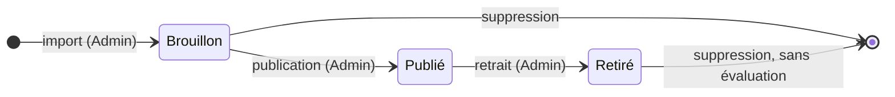

# 📋 Évaluations sur référentiels importés

> Évaluer un périmètre sur un référentiel que l'organisation importe elle-même : mesures
> d'ISO/IEC 27002, modèle de maturité (CR-CMM…), politique interne, référentiel sectoriel.
> Même outillage que la [conformité NIS 2](conformite-nis2.md) : questionnaire, preuves,
> scores, écarts, actions d'amélioration, comparaison, export. Code prévu :
> `backend/Modules/ComplianceAssessment`, `frontend/src/modules/compliance-assessment`.
> Préfixe des règles : **REF**. Socle commun et conventions (✅ / 🔜, lots) :
> [règles métier](../regles-metier.md). Décision :
> [ADR-0025](../../decisions/adr-0025-referentiels-de-conformite-importes.md) (proposé).
> Chantier F12 du [plan d'action](../../plan-action.md#7-feuille-de-route-fonctionnelle),
> spécifié le 2026-11-24.

[← Règles métier](../regles-metier.md) · [Toutes les pratiques](readme.md) · [Conformité NIS 2](conformite-nis2.md)

## 1. Objectif et périmètre

*Objectif ITIL 4 (gestion de la sécurité de l'information) : protéger l'information dont
l'organisation a besoin pour conduire ses activités, en comprenant et en gérant les risques
pour sa confidentialité, son intégrité et sa disponibilité.*

Un **référentiel importé** est une liste de **points de contrôle**, rangés par **domaine**
(ou pratique), chacun avec un identifiant, une question, et s'il y a lieu un **niveau** et la
**preuve attendue**. L'administrateur l'importe depuis un CSV, en associant les colonnes du
fichier à ces rôles, et règle son **échelle de réponse**. Une **évaluation** note chaque
point, calcule le score, le **niveau atteint** quand le référentiel en définit, liste les
écarts et alimente le registre d'**amélioration continue**.

**Contenu** : rien du référentiel n'entre dans le dépôt, ni texte ni structure. Les
intitulés d'ISO/IEC 27002 sont protégés par le droit d'auteur de l'ISO ; CR-CMM est sous
licence CC BY-NC 4.0 (usage interne libre, œuvre dérivée ou revente soumises à l'accord
écrit de ses auteurs, vérifié le 2026-10-12). L'organisation importe le référentiel sous sa
responsabilité et l'administrateur atteste qu'elle peut en faire usage (REF-03).

Hors périmètre : le référentiel NIS 2, qui garde sa structure embarquée
([ADR-0012](../../decisions/adr-0012-referentiel-nis2-structure-versionnee-texte-importe.md)) ;
la saisie d'un référentiel point par point dans l'interface ; la certification.

## 2. Rôles et droits

| Rôle ITIL | Rôle applicatif | Responsabilités |
|---|---|---|
| Responsable de la sécurité / de la conformité | Manager | Crée et pilote les évaluations, les valide, les rouvre |
| Contributeur | User | Répond aux points de contrôle de son domaine |
| Administrateur | Admin | Importe, publie, retire et supprime les référentiels ; supprime une évaluation |

| Action | User | Manager | Admin | Statut |
|---|---|---|---|---|
| Consulter les référentiels publiés et les évaluations | ✔ | ✔ | ✔ | 🔜 REF-14 |
| Répondre à un point de contrôle | ✔ | ✔ | ✔ | 🔜 REF-08 |
| Créer, modifier, valider, rouvrir une évaluation | ✘ | ✔ | ✔ | 🔜 REF-07 |
| Créer une action d'amélioration depuis un écart | ✘ | ✔ | ✔ | 🔜 REF-11 |
| Importer, publier, retirer, supprimer un référentiel ; régler son échelle | ✘ | ✘ | ✔ | 🔜 REF-01 à REF-06 |
| Supprimer une évaluation | ✘ | ✘ | ✔ | 🔜 REF-07 |

## 3. Données

### Référentiel (`Frameworks`)

Une ligne par **version** importée d'un référentiel.

| Champ | Type | Oblig. | Valeurs / règle | Statut |
|---|---|---|---|---|
| `Name` | texte 150 | ✔ | Nom du référentiel (« ISO/IEC 27002:2022 », « CR-CMM ») | 🔜 REF-03 |
| `Version` | texte 50 | ✔ | Libellé de version, unique pour un nom | 🔜 REF-03, REF-06 |
| `Publisher` | texte 150 | | Éditeur | 🔜 REF-03 |
| `Terms` | texte 2 000 | | Conditions d'utilisation, affichées sur le référentiel et ses évaluations | 🔜 REF-03 |
| `Status` | texte 20 | auto | Brouillon, Publié, Retiré | 🔜 REF-05 |
| `ScaleJson` | texte (JSON) | ✔ | Valeurs de l'échelle : libellé (50) et poids (0 à 1, au centième), dans l'ordre d'affichage | 🔜 REF-04 |
| `HasLevels` | booléen | auto | Vrai dès qu'un point porte un niveau | 🔜 REF-10 |
| `AttestedBy`, `AttestedAt` | texte, date | ✔ | Administrateur qui atteste le droit d'usage, et quand | 🔜 REF-03 |
| `ImportedBy`, `ImportedAt`, `PublishedAt`, `RetiredAt` | texte, dates | auto | | 🔜 REF-01, REF-05 |

### Point de contrôle (`FrameworkControls`)

| Champ | Type | Oblig. | Valeurs / règle | Statut |
|---|---|---|---|---|
| `Domain` | texte 200 | ✔ | Domaine ou pratique ; les domaines s'affichent dans l'ordre de leur première ligne | 🔜 REF-01 |
| `Identifier` | texte 50 | ✔ | Unique dans la version ; rapproche les points d'une version à l'autre | 🔜 REF-02, REF-12 |
| `Question` | texte 4 000 | ✔ | Texte du point, multiligne | 🔜 REF-01 |
| `Level` | entier | | 1 à 9 | 🔜 REF-02, REF-10 |
| `ExpectedEvidence` | texte 2 000 | | Preuve attendue, affichée au répondant | 🔜 REF-01 |
| `Order` | entier | auto | Ordre de la ligne dans le fichier | 🔜 REF-01 |

### Évaluation et réponse

Les évaluations sur un référentiel importé sont des évaluations du registre commun
(`Assessments`, `EVA-AAAA-NNNN`, [conformité NIS 2 § 3](conformite-nis2.md#3-données)),
avec ces écarts :

| Champ | Règle | Statut |
|---|---|---|
| `FrameworkId` (évaluation) | Version évaluée, choisie à la création parmi les versions publiées ; vide pour une évaluation NIS 2 ; ne change plus | 🔜 REF-07 |
| `EntityCategory` (évaluation) | Sans objet : tous les points de la version sont applicables | 🔜 REF-07 |
| `ControlId` (réponse) | Point de contrôle de la version évaluée | 🔜 REF-08 |
| `ScaleLabel`, `Weight` (réponse) | Libellé et poids de la valeur choisie, recopiés ; vides si non applicable | 🔜 REF-08 |
| `NotApplicable`, `Justification`, preuves | Comme NIS 2 ([NIS-04, NIS-05, NIS-08](conformite-nis2.md#5-règles-de-gestion)) | 🔜 REF-08 |

## 4. Cycle de vie

### Version d'un référentiel

| De → Vers | Qui | Conditions (400 ou 409 sinon) | Effets | Statut |
|---|---|---|---|---|
| — → Brouillon | Admin | Import valide (REF-02), attestation (REF-03) | Points, échelle | 🔜 REF-01 |
| Brouillon → Publié | Admin | | Ouverte aux nouvelles évaluations | 🔜 REF-05 |
| Publié → Retiré | Admin | | Plus de nouvelle évaluation ; les existantes restent consultables et se valident encore | 🔜 REF-05 |
| Brouillon ou Retiré → supprimé | Admin | Aucune évaluation ne vise la version (409) | Points supprimés | 🔜 REF-05 |

### Évaluation

Cycle de vie de NIS 2 : Brouillon → En cours (première réponse) → Validée (toutes les
réponses, non-applicabilités justifiées) → En cours (réouverture)
([conformité NIS 2 § 4](conformite-nis2.md#4-cycle-de-vie)). La réouverture ne change pas
la version évaluée (REF-07).

## 5. Règles de gestion

### Référentiels

| ID | Règle | Statut | Lot |
|---|---|---|---|
| REF-01 | **Import** réservé à l'Admin (Paramétrage › Référentiels importés), en trois étapes : dépôt d'un CSV (séparateur `;` ou `,`, UTF-8 avec ou sans BOM, champs multilignes, 5 Mio et 2 000 lignes de données au plus) ; **association des colonnes** : les en-têtes du fichier, chacun associé à un rôle (domaine, identifiant et question obligatoires ; niveau et preuve attendue facultatifs ; les autres colonnes ignorées), proposés d'après leur nom et modifiables, avec l'aperçu des 20 premières lignes ; enregistrement, qui crée la version en Brouillon | 🔜 | 3 |
| REF-02 | **Contrôles, tout ou rien** : un domaine, un identifiant ou une question vide, un identifiant en double, un niveau qui n'est pas un entier de 1 à 9 refusent l'import entier (400) ; le compte rendu cite chaque ligne fautive (numéro du fichier, motif ; 50 au plus, puis leur nombre) ; rien n'est enregistré. Un import accepté rend le nombre de points, de domaines et de niveaux | 🔜 | 3 |
| REF-03 | **Fiche d'une version** : nom, version (unique pour un nom, 409 sinon), éditeur, conditions d'utilisation ; l'Admin **atteste** que l'organisation peut faire usage de ce contenu (case obligatoire, 400 sinon ; nom et date conservés). Les conditions d'utilisation s'affichent sur le référentiel et sur chaque évaluation qui le vise | 🔜 | 3 |
| REF-04 | **Échelle de réponse** réglée par l'Admin : 2 à 6 valeurs, chacune un libellé (unique) et un poids de 0 à 1 au centième, dont au moins une de poids 1 et une de poids 0 (400 sinon) ; par défaut « Implémenté » 1, « Partiel » 0,5, « Non implémenté » 0. « Non applicable » s'ajoute toujours, hors échelle. L'échelle se modifie tant qu'aucune évaluation ne vise la version (409 ensuite) | 🔜 | 3 |
| REF-05 | **Statut** d'une version : Brouillon à l'import, invisible aux autres rôles ; **Publié** par l'Admin, seul statut qui accueille une évaluation nouvelle ; **Retiré** par l'Admin : plus d'évaluation nouvelle, les existantes restent consultables, se valident et se rouvrent. Suppression par l'Admin d'une version en Brouillon ou Retirée, sans évaluation (409 sinon) | 🔜 | 3 |
| REF-06 | **Nouvelle version** : un import sous un nom existant, avec un autre libellé de version, crée une version distincte ; ses points se rapprochent de ceux des versions précédentes par leur identifiant (REF-12). Publier une version ne retire pas les autres | 🔜 | 3 |
| REF-14 | Tout rôle **consulte** les versions publiées et retirées : domaines, points (question, niveau, preuve attendue), échelle, conditions d'utilisation ; l'Admin voit aussi les brouillons | 🔜 | 3 |

### Évaluations

| ID | Règle | Statut | Lot |
|---|---|---|---|
| REF-07 | Une évaluation vise **une version publiée**, choisie à la création (400 sinon), et ne change plus de version, réouverture comprise. Elle suit les règles des évaluations NIS 2 : droits, référence et statuts (NIS-02), passage en cours (NIS-03), validation et non-applicabilité justifiée (NIS-05), évaluation validée figée (NIS-06), réouverture (NIS-07), revue périodique (NIS-16), notifications (NIS-24), périmètres ([PER](../perimetres.md)). Tous les points de la version sont applicables : pas de catégorie d'entité | 🔜 | 3 |
| REF-08 | Tout rôle **répond** à un point de la version évaluée : une valeur de l'échelle (son libellé et son poids sont recopiés dans la réponse) ou « non applicable » avec justification ; un point d'une autre version ⇒ 400. Preuves comme NIS 2 ([NIS-08](conformite-nis2.md#5-règles-de-gestion)) ; la preuve attendue du point s'affiche à côté de la réponse | 🔜 | 3 |
| REF-12 | **Comparaison** de deux évaluations d'un même référentiel (même nom, versions éventuellement différentes) et d'un même périmètre : score et niveau atteint, global et par domaine ; réponses qui diffèrent, points rapprochés par leur identifiant ; points présents dans une seule des deux versions listés à part. Entre deux référentiels ou deux périmètres : 400 | 🔜 | 3 |
| REF-13 | **Export** de la synthèse pour les auditeurs (CSV `;`, BOM UTF-8) : une ligne par point évalué — domaine, identifiant, niveau, question, réponse (libellé et poids), non-applicabilité, justification, preuves, écart, action liée et son statut ; en tête, le référentiel, sa version et ses conditions d'utilisation | 🔜 | 3 |

## 6. Délais, calculs et alertes

| ID | Règle | Statut | Lot |
|---|---|---|---|
| REF-09 | **Score** (%) = Σ poids des réponses notées / nombre de réponses notées × 100, arrondi au dixième ; « non applicable » et points sans réponse exclus ; par domaine et global, chaque point pesant autant ; vide s'il n'y a aucune réponse notée | 🔜 | 3 |
| REF-10 | **Niveau atteint**, si la version a des niveaux : le plus haut niveau N tel que tout point applicable de niveau inférieur ou égal à N est noté à une valeur de **poids 1** ; 0 si le niveau 1 n'est pas atteint ; un niveau sans point applicable est franchi. Calculé globalement et par domaine, avec la **progression** du niveau suivant : part de ses points applicables notés à poids 1 (« niveau 2 atteint ; niveau 3 : 60 % »). Les points sans niveau comptent dans le score, pas dans les niveaux. Une version sans niveau n'a qu'un score | 🔜 | 3 |
| REF-11 | **Écart** d'un point = 1 − poids ; liste des écarts triée par niveau croissant (les écarts qui bloquent le niveau suivant d'abord), puis par écart décroissant. **Action d'amélioration** depuis un écart, comme [NIS-15](conformite-nis2.md#6-délais-calculs-et-alertes) : enregistrement AMI à l'étape 2, priorité Élevée si le poids est inférieur à 0,5, sinon Moyenne, mesure de départ = libellé de la réponse, cible = la valeur de poids 1 ; relié à l'évaluation ; un seul par point (409 avec la référence existante) ; refusé sans écart (400) | 🔜 | 3 |
| REF-15 | **Reporting**, onglet Conformité : pour chaque référentiel importé, la dernière évaluation validée de chaque périmètre visible, son score, son niveau atteint et l'évolution depuis la précédente ([REP](../reporting.md)) | 🔜 | 3 |

## 7. Liens avec les autres pratiques

| Lien | Sens | Règle | Statut |
|---|---|---|---|
| Évaluation → Amélioration | Traitement d'un écart | REF-11, [CSI-10](amelioration-continue.md) | 🔜 |
| Évaluation → Changement, Article, CI | Preuves de mise en œuvre | REF-08 | 🔜 |
| Évaluation → Évaluation | Évaluation précédente du même référentiel et du même périmètre | REF-12 | 🔜 |

## 8. Console et indicateurs

Console : les évaluations sur référentiels importés figurent avec celles de NIS 2 dans Mon
travail (ouvertes, dont je suis le responsable) et dans Revues échues (à renouveler, NIS-16) 🔜.

| Indicateur | Calcul | Statut |
|---|---|---|
| Score global et par domaine | REF-09 | 🔜 |
| Niveau atteint et progression du niveau suivant | REF-10 | 🔜 |
| Écarts | REF-11 | 🔜 |
| Évolution entre deux évaluations | REF-12, REF-15 | 🔜 |

### Interface

- **Paramétrage › Référentiels importés** (Admin) : versions par référentiel avec leur
  statut et le nombre d'évaluations ; assistant d'import (fichier, colonnes et aperçu,
  fiche, échelle et attestation, compte rendu) ; publier, retirer, supprimer ; échelle
  modifiable tant qu'aucune évaluation ne vise la version.
- **Conformité & réglementation › Référentiels** : registre des évaluations sur
  référentiels importés, filtrable par référentiel ; création (titre, périmètre, version
  publiée) ; consultation des référentiels publiés.
- **Fiche** d'une évaluation : Informations · **Questionnaire** · **Synthèse** ·
  Comparaison · Liens · Pièces jointes.
  - *Questionnaire* : points regroupés par domaine (blocs repliables), niveau et preuve
    attendue affichés, filtre par niveau ; réponse par les valeurs de l'échelle ou « non
    applicable » ; lecture seule si l'évaluation est validée.
  - *Synthèse* : score global, niveau atteint et progression, couverture, scores et
    niveaux par domaine, écarts triés avec « Créer une action d'amélioration » ;
    conditions d'utilisation du référentiel en pied.

## 9. API

| Route | Policy | Rôle |
|---|---|---|
| `GET /api/frameworks`, `GET /api/frameworks/{id}` | User | Versions publiées et retirées (brouillons pour l'Admin), avec points et échelle (REF-14) |
| `POST /api/frameworks/import/preview` (fichier) | Admin | En-têtes, 20 premières lignes, association proposée (REF-01) ; rien n'est enregistré |
| `POST /api/frameworks/import` (fichier, association, fiche, échelle, attestation) | Admin | Crée la version en Brouillon (201) ; 400 avec le compte rendu (REF-02) ; 409 si la version existe (REF-03) |
| `PUT /api/frameworks/{id}` | Admin | Fiche, échelle (409 si une évaluation vise la version), publication, retrait (REF-03 à REF-05) |
| `DELETE /api/frameworks/{id}` | Admin | Suppression d'un brouillon ou d'une version retirée sans évaluation (409 sinon) |
| `POST /api/assessments` (`frameworkId`) et routes de la fiche | Manager, User | Comme NIS 2 ([§ 9](conformite-nis2.md#9-api)) : questionnaire, réponses (`controlId`, `scaleLabel`), score et niveau, comparaison, export, actions d'amélioration (`identifier`) |

## 10. Scénarios d'acceptation

- **REF-02** — *Étant donné* un CSV dont deux lignes portent l'identifiant « GV.1 » et une
  troisième le niveau « 2,5 », *quand* l'Admin l'importe, *alors* 400, le compte rendu cite
  les trois lignes avec leur motif et aucun point n'est enregistré.
- **REF-04** — *Étant donné* une échelle « Oui » 1, « En partie » 0,4, *quand* l'Admin
  l'enregistre, *alors* 400 (aucune valeur de poids 0) ; *étant donné* une évaluation qui
  vise la version, *quand* il modifie l'échelle, *alors* 409.
- **REF-05** — *Étant donné* une version en Brouillon, *quand* un Manager crée une
  évaluation qui la vise, *alors* 400 ; publiée, l'évaluation est créée ; retirée, 400 de
  nouveau, et les évaluations existantes restent consultables.
- **REF-09** — *Étant donné* l'échelle par défaut et quatre réponses « Implémenté »,
  « Partiel », « Non implémenté » et « non applicable », *alors* le score vaut 50,0 %
  (1,5 / 3).
- **REF-10** — *Étant donné* les points A et B de niveau 1, C et D de niveau 2, E de
  niveau 3, *quand* A est « Implémenté », B « non applicable » justifié, C « Implémenté »,
  D « Partiel » et E « Implémenté », *alors* le niveau atteint vaut 1, la progression du
  niveau 2 vaut 50 % et le score 87,5 %.
- **REF-11** — *Étant donné* le point D noté « Partiel », *quand* un Manager crée l'action
  d'amélioration, *alors* un AMI à l'étape 2, priorité Moyenne, est créé et relié ; une
  seconde demande renvoie 409 avec la référence existante.
- **REF-12** — *Étant donné* deux évaluations validées du même périmètre sur les versions
  2025 et 2026 d'un référentiel, dont la seconde ajoute le point « GV.9 », *alors* la
  comparaison rapproche les points communs par identifiant et liste « GV.9 » à part.
