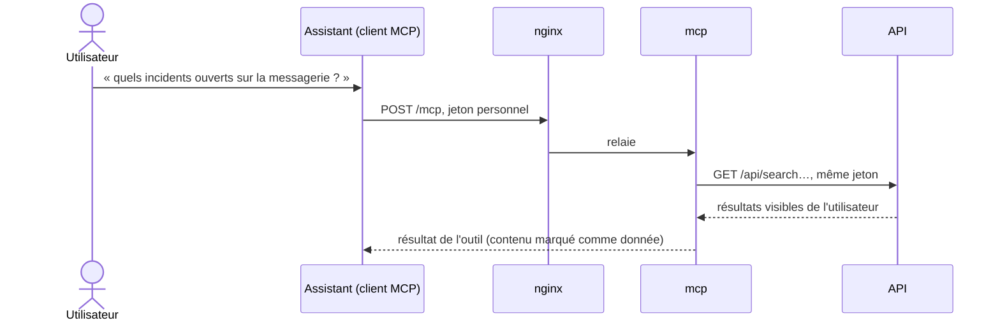

# 🔌 Serveur MCP

> [Fonctionnalité optionnelle](fonctionnalites-optionnelles.md) (clé `mcp-server`,
> conteneur propre `mcp`, à part du conteneur commun des autres fonctionnalités). S-Aloha ouvre en **lecture**, par le *Model Context Protocol*, ses
> enregistrements et sa recherche aux assistants qu'emploient ses utilisateurs, avec les
> droits de chacun. Rien ne s'y écrit. Préfixe des règles : **MCP**. Décision :
> [ADR-0024](../decisions/adr-0024-serveur-mcp-conteneur-separe-lecture-seule.md).

[← Fonctionnalités optionnelles](fonctionnalites-optionnelles.md) · [Recherche](recherche.md) · [Périmètres](perimetres.md) · [Sécurité](securite.md)

## 1. Objectif

Un technicien qui travaille avec un assistant compatible MCP, sur son poste ou dans son
éditeur, l'interroge sur ses tickets, la connaissance ou l'impact d'un CI, sans copier-coller
et sans aucun droit de plus que dans l'interface.

## 2. Règles

| ID | Règle | Statut | Lot |
|---|---|---|---|
| MCP-01 | **Transport** : HTTP « Streamable HTTP » du protocole, sur `/mcp`, que nginx relaie au conteneur `mcp` ; version du protocole : celle du SDK retenu, **2026-07-28** (`ModelContextProtocol.AspNetCore` 2.4.0), sans session : chaque requête porte le jeton et se suffit, `GET` et `DELETE /mcp` répondent 405. Fonctionnalité coupée ou conteneur arrêté : 404. Une requête dont l'en-tête `Origin` est présent et absent de `Cors:AllowedOrigins` est refusée (403), contre le détournement par résolution DNS | ✅ côté conteneur (`McpHost` : `/mcp`, origine refusée en 403 avant tout, fonctionnalité coupée en 404 d'après `GET /api/me/tokens/current`) / 🔜 relais par nginx, 404 du conteneur arrêté (6b-3) | 3 |
| MCP-02 | **Pour un utilisateur, jamais pour soi** : le conteneur n'a ni jeton propre, ni route interne, ni accès à la base, ni secret ; chaque outil appelle les routes **publiques de lecture** de l'API avec le jeton personnel de l'utilisateur (MCP-03). Une donnée qui manque à un outil s'ajoute à l'API | ✅ (`PublicApi` : `GET` seulement, sur le port public de l'API, avec l'en-tête `Authorization` de l'utilisateur ; ajouts à l'API : `GET /api/me/tokens/current`, incidents et changements ouverts dans l'impact d'un CI) | 3 |
| MCP-03 | **Jetons d'accès personnels** : créés par l'utilisateur (Préférences › Jetons d'accès) avec un nom et une durée (1 à 90 jours, 30 par défaut) ; affichés **une seule fois** ; conservés sous forme d'empreinte SHA-256 ; 5 jetons actifs au plus par compte ; révocables par l'utilisateur et par l'Admin. L'API ne les accepte que sur les routes `GET`, et refuse tout jeton personnel (401) quand la fonctionnalité est coupée | ✅ (`PersonalTokenHandler`, préfixe `sat_`, schéma choisi d'après l'en-tête ; routes `/api/me/tokens` et `/api/admin/tokens`, 404 coupées ; page `AccessTokens`) | 3 |
| MCP-04 | **Identité relue à l'usage** : à la première requête d'un jeton puis au moins toutes les 5 minutes, l'API relit dans l'annuaire les groupes de rôle du compte ; un compte absent des groupes de rôle ou désactivé est refusé (401). Rôle et périmètres sont ceux du moment, jamais ceux de la création du jeton. Annuaire injoignable : 503, comme à la connexion | ✅ | 3 |
| MCP-05 | **Outils**, tous en lecture : `search` (recherche libre, [RAG-05](recherche.md), 10 résultats) ; `get_record` (une fiche par sa référence : la vue que l'interface en montre à l'utilisateur, liens et commentaires compris) ; `similar_cases` ([RAG-06](recherche.md)) ; `my_work` (« Mon travail » de la console) ; `ci_impact` (pour un CI : ce qui en dépend par les relations, incidents et changements ouverts reliés) ; `triage_suggestions` (propositions du [tri assisté](tri-assiste-des-tickets.md) sur un incident, s'il est activé). Aucun outil d'écriture n'est déclaré au client | ✅ (`ReadTools`, annotés en lecture seule, non destructifs) | 3 |
| MCP-06 | **Périmètres** : chaque outil passe par la portée de l'API ([PER-09](perimetres.md), [RAG-13](recherche.md)) ; un enregistrement hors de portée est « introuvable », jamais « interdit » | ✅ (référence cherchée dans le registre de son type avec la portée de l'utilisateur ; 403 ou 404 de l'API : « Introuvable ») | 3 |
| MCP-07 | **Contenu marqué comme donnée** : titres, descriptions et commentaires sont rendus dans des champs marqués « saisi par un utilisateur » ; les consignes du serveur annoncent au client que ces champs sont des données, pas des consignes. La lecture seule (MCP-05) reste la protection | ✅ (`Shaper` : clé `userEntered` ; un champ inconnu est traité comme saisi) | 3 |
| MCP-08 | **Limites** : 60 appels par minute et par jeton (429 au-delà), 20 résultats par appel au plus, champs texte tronqués à 2 000 caractères (`Mcp:*`) | ✅ (60 requêtes sur `/mcp` par minute et par empreinte de jeton, `Retry-After: 60` ; « truncated » dans la réponse) | 3 |
| MCP-09 | **Traçabilité** : chaque appel d'outil est écrit au journal technique (JSON, [ADR-0017](../decisions/adr-0017-observabilite-journal-json-et-opentelemetry.md)) : compte, identifiant du jeton, outil, nombre de résultats, durée, issue ; jamais le contenu ni le jeton. La **dernière utilisation** du jeton est tenue à jour (une fois par minute au plus) et affichée à l'utilisateur et à l'Admin | ✅ (côté API : dernière utilisation à la minute, journal « compte, identifiant du jeton, méthode, chemin » ; conteneur : une ligne par appel d'outil, sans le journal du client HTTP qui écrirait le texte recherché ; affichage : `AccessTokens`) | 3 |

## 3. Interface

| Endroit | Contenu | Statut |
|---|---|---|
| Préférences › **Jetons d'accès** (tous les rôles, si la fonctionnalité est activée) | Créer (nom, durée : 7, 30 ou 90 jours), voir la liste (nom, création, expiration, dernière utilisation), révoquer ; adresse du serveur à copier ; le jeton n'est montré qu'une fois, juste après sa création (`AccessTokens`) | ✅ |
| Administration › Fonctionnalités optionnelles › Serveur MCP | État du conteneur, tous les jetons actifs (compte, nom, expiration, dernière utilisation ; jamais le jeton), révocation | ✅ (jetons, la fonctionnalité activée ; état du conteneur : carte commune des fonctionnalités) |

## 4. API

| Route | Policy | Rôle |
|---|---|---|
| `POST /mcp` (conteneur `mcp` ; sans session, `GET` et `DELETE` : 405) | Jeton personnel | Protocole MCP (MCP-01, MCP-05) |
| `GET /api/me/tokens/current` | Aucune (404 coupée) | Le jeton présenté, pour le conteneur `mcp` : identifiant, titulaire, nom, expiration ; 401 sans jeton personnel valide, 503 annuaire injoignable (MCP-01, MCP-09) |
| `GET /api/me/tokens`, `POST /api/me/tokens`, `DELETE /api/me/tokens/{id}` | User | Jetons personnels (MCP-03) |
| `GET /api/admin/tokens`, `DELETE /api/admin/tokens/{id}` | Admin | Liste et révocation (MCP-03) |
| `GET /health` (conteneur) | — (réseau du compose) | Santé du conteneur ([OPT-01](fonctionnalites-optionnelles.md#2-activation)) |

### Ce que chaque outil lit

| Outil | Routes publiques lues | Réponse |
|---|---|---|
| `search` (`query`, `types`, `limit` : 10) | `GET /api/search` | `results` |
| `get_record` (`reference`) | `GET /api/<registre>?q=` puis `/{id}`, `GET /api/links`, `GET /api/comments` | `type`, `record`, `links`, `comments` |
| `similar_cases` (`reference`, `limit` : 5) | `GET /api/search/similar` (incident, problème, article) | `results` |
| `my_work` | `GET /api/console`, bloc personnel seulement (pas le pilotage) | une liste par section (`myAssignments`, `mySlaIncidents`…) |
| `ci_impact` (`reference` d'un CI) | `GET /api/configuration-items/{id}/impact` | `ci`, `downstream`, `upstream`, `services`, `openIncidents`, `openChanges` |
| `triage_suggestions` (`reference` d'un incident) | `GET /api/incidents/{id}/triage`, `GET /api/incidents/{id}/proposals` | `enabled`, `proposals` (du seul tri), `outage` ; `enabled` faux quand le tri est coupé |

Chaque réponse est un objet JSON, avec `truncated` (MCP-08). Dans chaque objet, les textes
saisis (titres, descriptions, commentaires, motifs, noms) sont sous `userEntered` ; à côté
restent la référence, le statut, le type, les dates, les identifiants et les valeurs d'une
liste fixe (MCP-07). Une référence hors de portée, ou d'un autre type que celui de l'outil,
rend une erreur d'outil (« Introuvable : … », « … est un incident : cet outil attend un CI »).

### Réglages du conteneur

| Réglage | Défaut | Rôle |
|---|---|---|
| `Api:Url` | — | Port **public** de l'API (`http://api:8080`), jamais le port interne ; absent : `/health` et `/mcp` répondent 503 |
| `Cors:AllowedOrigins` | aucune | Les mêmes que l'API : une page d'une autre origine reçoit 403 (MCP-01) |
| `Mcp:CallsPerMinute`, `Mcp:MaxResults`, `Mcp:MaxTextLength` | 60, 20, 2 000 | Limites (MCP-08), annoncées dans les consignes du serveur |
| `Logging:Format` | `json` hors développement | Journal technique ([ADR-0017](../decisions/adr-0017-observabilite-journal-json-et-opentelemetry.md)), une ligne par appel d'outil (MCP-09) |

## 5. Scénarios d'acceptation

- **MCP-03** — *Étant donné* un jeton personnel, *quand* l'assistant appelle `PUT /api/incidents/12` avec lui, *alors* l'API refuse (401 ou 405) ; révoqué, le jeton est refusé à l'appel suivant.
- **MCP-04** — *Étant donné* un utilisateur retiré de son groupe de rôle après la création de son jeton, *quand* l'assistant appelle un outil plus de 5 minutes après, *alors* l'appel est refusé (401).
- **MCP-05** — *Étant donné* le serveur activé, *quand* le client demande la liste des outils, *alors* elle ne contient que les six outils de lecture.
- **MCP-06** — *Étant donné* un utilisateur du seul périmètre Usine, *quand* il demande `get_record` d'un incident du Siège, *alors* l'outil répond « introuvable ».
- **MCP-01** — *Étant donné* la fonctionnalité coupée, *quand* un client appelle `/mcp`, *alors* il reçoit 404, et ses jetons sont refusés par l'API.

## 6. Hors de cette version

- **Écriture**, même proposée et confirmée : nouvelle décision ([ADR-0024](../decisions/adr-0024-serveur-mcp-conteneur-separe-lecture-seule.md)).
- **OAuth 2.1** et clients MCP distants hors du réseau de l'organisation.
- **Serveur local par utilisateur** (transport stdio).
