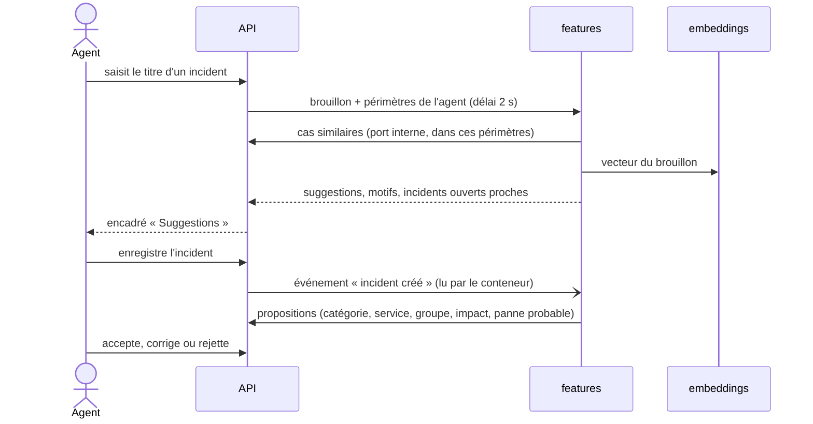

# 🔀 Tri assisté des tickets

> [Fonctionnalité optionnelle](fonctionnalites-optionnelles.md) (clé `assisted-ticket-triage`,
> conteneur commun `features`). À la saisie et à chaque enregistrement d'un incident,
> S-Aloha suggère sa catégorie, son service, son groupe responsable et son impact, avec
> leurs motifs, et signale les incidents ouverts qui semblent relever de la même panne.
> Aucune suggestion n'est appliquée seule : l'agent décide. Sans modèle de langage :
> le tri s'appuie sur la [recherche](recherche.md) et sur des règles. Préfixe des règles :
> **TRI**. Décision : [ADR-0023](../decisions/adr-0023-fonctionnalites-optionnelles-et-modele-de-langage.md).

[← Fonctionnalités optionnelles](fonctionnalites-optionnelles.md) · [Gestion des incidents](processus/gestion-des-incidents.md) · [Recherche](recherche.md) · [Règles métier](regles-metier.md)

## 1. Objectif

Réduire le temps passé à qualifier et aiguiller un incident (catégorisation, priorisation,
affectation, ITIL 4 *Incident management*), et repérer tôt une panne qui touche plusieurs
utilisateurs. Le tri **propose** ; la décision, et la responsabilité, restent à l'agent.

Ce qui existe déjà, et que le tri ne refait pas :

| Existant | Règle |
|---|---|
| Priorité calculée par la matrice impact × urgence | [SOC-16](regles-metier.md#6-priorité), [INC-02](processus/gestion-des-incidents.md) |
| Cas similaires, dès la saisie | [RAG-06, RAG-11](recherche.md) |
| Doublons probables, fusion par l'Admin | [ADM-40, ADM-41](administration.md#5-nettoyage-des-doublons) |
| Incident parent et incidents enfants | [INC-16](processus/gestion-des-incidents.md) |
| Incident majeur, déclaré par un Manager | [INC-13](processus/gestion-des-incidents.md) |
| SLA en risque | [INC-24](processus/gestion-des-incidents.md) |
| Escalade vers un autre groupe, avec motif | [INC-17](processus/gestion-des-incidents.md) |

Le tri suggère l'**impact**, jamais la priorité : celle-ci reste calculée par la matrice.

## 2. Fonctionnement

## 3. Règles

| ID | Règle | Statut | Lot |
|---|---|---|---|
| TRI-01 | **Portée** : les incidents, à la création et tant qu'ils sont Nouveau ou En cours. Les demandes de service n'entrent pas dans cette version (§ 7) | ✅ (en tâche de fond, par le fil d'événements ; à la saisie avec l'interface, 3c) | |
| TRI-02 | **Deux moments** : à la **saisie**, dans le formulaire de création, dès 4 caractères de titre après une courte pause de frappe (comme [RAG-11](recherche.md)), par un appel de l'API au conteneur borné à 2 secondes ([OPT-16](fonctionnalites-optionnelles.md#3-contrat-entre-lapi-et-le-conteneur-des-fonctionnalités)) ; après chaque **enregistrement**, par le fil d'événements ([OPT-12](fonctionnalites-optionnelles.md#3-contrat-entre-lapi-et-le-conteneur-des-fonctionnalités)), en propositions sur la fiche. Une panne du conteneur ne bloque jamais la saisie ni l'enregistrement | 🔜 | 3 |
| TRI-03 | **Catégorie, service et groupe par vote des voisins** : les 10 incidents résolus ou clos les plus proches ([RAG-06](recherche.md), au-dessus du plancher de [RAG-10](recherche.md)) votent, chacun pour sa catégorie (active, [ADM-51](administration.md#6-catégories-paramétrage)), son service (en service au catalogue) et son groupe responsable (un responsable de type Groupe AD ; un voisin confié à une personne ne vote pas pour le groupe). Une valeur n'est suggérée que si elle réunit au moins 3 votants et la moitié des votants au moins, et si elle diffère de la valeur saisie ; deux valeurs à égalité en tête ne départagent rien, aucune suggestion. Sans service d'embeddings, les voisins viennent des mots seuls ([RAG-02](recherche.md)), et le motif le dit | ✅ (en tâche de fond, dans le conteneur `features` ; à la saisie avec 3c ; réglages avec TRI-13) | |
| TRI-04 | **Impact** : la plus haute des deux valeurs suivantes est suggérée, si elle diffère de la valeur saisie. Criticité du **service** : Élevée → Élevé, Moyenne → Moyen, Faible → Faible. Criticité d'un **CI relié** ([CFG-43](processus/gestion-de-la-configuration.md)) : Vitale ou Majeure → Élevé, Standard → Moyen, Mineure → Faible. Une **panne probable** (TRI-07) suggère Élevé. La priorité suit la matrice, si l'agent accepte. Le motif nomme le service, partagé par toute l'organisation ; un CI y est cité sans être nommé (« CI relié de criticité Vitale », TRI-11) | ✅ (service et CI reliés ; panne probable avec TRI-07) | |
| TRI-05 | **Corrélation par règles** : deux incidents ouverts (Nouveau, En cours, En attente) d'un même périmètre sont **liés probables** s'ils portent le même service ou sont reliés au même CI, et ont été créés à moins de 60 minutes d'intervalle (`Triage:CorrelationWindowMinutes`) | 🔜 | 3 |
| TRI-06 | **Corrélation par le sens** : le conteneur `features` tient, pour le tri, un **index propre des incidents ouverts** (titre et description, 2 000 caractères au plus, vecteurs du service d'embeddings), en mémoire, reconstruit à son démarrage depuis l'API et tenu à jour par le fil d'événements ; un incident résolu, clos ou supprimé en sort. Deux incidents ouverts d'un même périmètre, créés dans la même fenêtre que TRI-05, sont liés probables si leur similarité cosinus atteint le seuil (`Triage:CorrelationMinSimilarity`, 0,60 provisoire, à calibrer : TRI-12). Cet index ne sert **jamais** la recherche ni les cas similaires : l'index de la recherche ne contient toujours que du contenu validé ([RAG-01](recherche.md)). Sans service d'embeddings, seule TRI-05 joue | 🔜 | 3 |
| TRI-07 | **Panne probable** : au moins 3 incidents liés probables (`Triage:OutageThreshold`), par TRI-05 ou TRI-06, forment une panne probable. Chaque fiche du groupe affiche un bandeau (« 4 incidents ouverts sur Messagerie depuis 09:12 ») qui propose de les **rattacher à un parent** (le plus ancien du groupe, ou son parent s'il en a un, [INC-16](processus/gestion-des-incidents.md)) ; aux Managers du périmètre, il propose aussi de **déclarer le parent majeur** ([INC-13](processus/gestion-des-incidents.md)). Les gestionnaires du périmètre reçoivent une notification ([SOC-21](regles-metier.md#8-notifications)) à la formation du groupe, une seule fois par groupe | 🔜 | 3 |
| TRI-08 | **Motifs** : chaque suggestion dit pourquoi, en clair, et cite ses sources visibles : « 7 des 10 incidents résolus les plus proches portent la catégorie Messagerie », « service Messagerie, criticité Élevée », « 4 incidents ouverts sur le service Messagerie depuis 09:12 », « par les mots seuls » | ✅ (motifs et sources des propositions ; affichage avec l'interface, 3c) | |
| TRI-09 | **Décision** ([OPT-15](fonctionnalites-optionnelles.md#3-contrat-entre-lapi-et-le-conteneur-des-fonctionnalités)) : l'agent accepte, corrige ou rejette. À la saisie, accepter remplit le champ du formulaire ; l'enregistrement porte alors les suggestions retenues, pour l'origine du journal d'audit ([OPT-08](fonctionnalites-optionnelles.md#2-activation)) et la mesure (TRI-10). Sur une fiche, accepter un **groupe** change le responsable : c'est une escalade ([INC-17](processus/gestion-des-incidents.md)), dont le motif est prérempli (« Tri assisté : 7 des 10 incidents proches traités par GRP-RESEAU »), modifiable. Rattacher à un parent et déclarer majeur suivent leurs propres règles | 🔜 | 3 |
| TRI-10 | **Mesure** : pour chaque champ, sur 30 et 90 jours, la part des suggestions acceptées, corrigées (autre valeur retenue), rejetées et laissées (aucune décision avant que l'incident quitte « Nouveau ») ; affichée dans Administration › Fonctionnalités optionnelles › Tri assisté. Un champ dont les suggestions sont surtout corrigées se coupe (TRI-13) | 🔜 | 3 |
| TRI-11 | **Visibilité** : à la saisie, les voisins et les incidents proches sont cherchés dans les périmètres visibles de l'agent ; en tâche de fond, dans le périmètre de l'incident ([OPT-13](fonctionnalites-optionnelles.md#3-contrat-entre-lapi-et-le-conteneur-des-fonctionnalités)). Une panne probable ne regroupe jamais deux périmètres. Un utilisateur ne voit les suggestions que d'un incident qu'il voit, et les motifs ne citent que ce qu'il voit | 🔜 | 3 |
| TRI-12 | **Calibrage** : avant la version stable, un jeu d'essai fictif d'au moins 30 incidents, dont des pannes à plusieurs incidents et des incidents isolés, mesure la précision du vote (TRI-03) et de la corrélation (TRI-06) ; le seuil de similarité et le nombre de voisins sont fixés d'après la mesure, consignée ici (même démarche que [RAG-10](recherche.md)) | 🔜 | 3 |
| TRI-13 | **Réglages** (Admin) : nombre de voisins (5 à 20, 10), votants minimaux (2 à 10, 3), part minimale (50 à 100 %, 50), fenêtre de corrélation (15 à 240 minutes, 60), seuil de panne probable (2 à 20, 3), seuil de similarité (0,40 à 0,95), et chaque suggestion (catégorie, service, groupe, impact, panne probable) activable à part | 🔜 | 3 |
| TRI-14 | **Conservation** : celle des propositions ([OPT-17](fonctionnalites-optionnelles.md#3-contrat-entre-lapi-et-le-conteneur-des-fonctionnalités)) ; l'index des incidents ouverts n'existe que dans la mémoire du conteneur | 🔜 | 3 |

## 4. Interface

| Endroit | Contenu | Statut |
|---|---|---|
| Formulaire de création d'un incident | Encadré « **Suggestions** » sous les cas similaires : une ligne par champ (« Catégorie : Messagerie — 7 des 10 incidents proches »), bouton « Appliquer » ; incidents ouverts proches, s'il y en a | 🔜 |
| Fiche incident, onglet Informations | Même encadré tant que l'incident est Nouveau ou En cours (accepter, corriger, rejeter) ; bandeau « **Panne probable** » (TRI-07) | 🔜 |
| Onglet Historique | Origine « Tri assisté des tickets » des modifications acceptées ([OPT-08](fonctionnalites-optionnelles.md#2-activation)) | 🔜 |
| Administration › Fonctionnalités optionnelles › Tri assisté | Réglages (TRI-13), mesure (TRI-10), état de l'index des incidents ouverts (nombre, dernier rattrapage) | 🔜 |

## 5. API

| Route | Policy | Rôle |
|---|---|---|
| `POST /api/triage/suggest` (titre, description, service, CI reliés) | User | Suggestions à la saisie, relayées au conteneur (TRI-02) |
| `GET /api/incidents/{id}/triage` | User, incident visible (404 sinon) | Propositions et panne probable d'un incident (TRI-07, TRI-08) |
| Décision | — | Routes communes des propositions ([OPT-15](fonctionnalites-optionnelles.md#6-api)) |
| `GET /api/admin/triage/metrics` | Admin | Mesure (TRI-10) |
| `GET /internal/incidents/{id}` | Jeton du conteneur `features`, port interne, tri activé (403 sinon) | Un incident dans sa vue publique, et les identifiants des CI qui lui sont reliés, dans un sens ou dans l'autre (OPT-13, TRI-04) : `{ "incident", "configurationItemIds" }` ; 404 s'il n'existe pas |
| `POST /internal/search/similar` (titre, description, périmètres, incident exclu, nombre : 10 par défaut, 20 au plus) | Jeton du conteneur `features`, port interne, tri activé | Voisins du vote (TRI-03) : les incidents résolus ou clos les plus proches, par la recherche des cas similaires (RAG-06, plancher de RAG-10), dans les seuls périmètres donnés, ceux de l'agent à la saisie et celui de l'incident en tâche de fond (TRI-11) ; `{ "semantic", "neighbours": [{ "score", "lexical", "semantic", "incident" }] }`, où `semantic` faux signale les mots seuls (RAG-02). Titre et périmètres requis (400) |
| `GET /internal/configuration-items?ids=<50 au plus>`, `GET /internal/services` | Jeton du conteneur `features`, port interne, tri ou CMDB assistée activés | CI et services dans leur vue publique : criticité (TRI-04), statut d'un service voté (TRI-03) |
| `GET /internal/categories?practice=incident` | Jeton du conteneur `features`, port interne, tri activé | Catégories dans leur vue publique : un voisin ne vote que pour une catégorie active (TRI-03, ADM-51) |
| `GET /internal/incidents/open` | Jeton du conteneur `features`, port interne, tri activé | Incidents ouverts, pour l'index propre du conteneur (TRI-06) ; avec la corrélation (#365, 3b) |
| `POST /triage/suggest`, `GET /health` (conteneur `features`) | Jeton du conteneur | Appelées par l'API (OPT-16, OPT-01) |

## 6. Scénarios d'acceptation

- **TRI-02** — *Étant donné* le conteneur `features` arrêté, *quand* un agent crée un incident, *alors* le formulaire n'affiche aucune suggestion, l'incident s'enregistre, et au redémarrage du conteneur ses propositions apparaissent sur la fiche.
- **TRI-03** — *Étant donné* 10 incidents résolus proches, dont 7 en catégorie Messagerie et 3 en Réseau, *quand* un agent saisit « Outlook ne reçoit plus les courriels », *alors* le tri suggère « Messagerie — 7 des 10 incidents proches » ; avec 2 votants seulement, il ne suggère rien.
- **TRI-05** — *Étant donné* trois incidents ouverts sur le service Messagerie créés en 20 minutes dans le périmètre Siège, *alors* chacun affiche le bandeau « Panne probable » et les gestionnaires du Siège reçoivent une notification, une seule ; un quatrième incident du même service dans le périmètre Usine n'entre pas dans le groupe.
- **TRI-06** — *Étant donné* deux incidents ouverts « VPN injoignable depuis le site de Lyon » et « impossible de me connecter au VPN », sans service commun, *quand* leur similarité dépasse le seuil, *alors* ils sont liés probables ; *quand* l'un est résolu, *alors* il sort de l'index du conteneur, et la recherche ne l'a jamais servi tant qu'il était ouvert.
- **TRI-09** — *Étant donné* une suggestion de groupe GRP-RESEAU sur un incident confié à GRP-SUPPORT, *quand* l'agent l'accepte, *alors* l'escalade est tracée avec le motif prérempli et l'origine « Tri assisté des tickets ».
- **TRI-11** — *Étant donné* un agent du seul périmètre Usine, *quand* il saisit un incident, *alors* aucun voisin ni motif ne cite un incident du Siège.

## 7. Hors de cette version

- **Demandes de service** : suggérer le modèle du catalogue et le groupe d'une demande
  demande d'indexer les demandes réalisées, ce que la recherche ne fait pas
  ([recherche § 2](recherche.md#2-contenu-indexé)) ; à spécifier.
- **Modèle de langage** (extraire d'un texte libre le service ou le CI concernés) :
  envisagé seulement si la mesure de TRI-10 montre un manque que les voisins ne comblent
  pas ; nouvelle décision.
- **Application sans décision humaine** : jamais ([ADR-0023](../decisions/adr-0023-fonctionnalites-optionnelles-et-modele-de-langage.md)).
